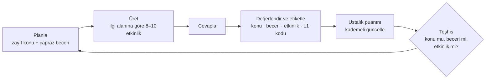

# PRD — Kaynak (çalışma adı)

**Türkçe konuşan hazırlık öğrencileri için hatanın kaynağını bulan yapay zekâ İngilizce öğretmeni**

| | |
| --- | --- |
| Sürüm | v1 (MVP / pilot) · rev. 2 |
| Tarih | 10 Kasım 2026 |
| Ekip | Mühendis (bilgisayar müh., PoliTo) · Pedagoji (İngilizce öğretmenliği, ALKÜ) |
| İlgili belgeler | `SPEC.md` (teknik) · `SCOPE.md` (kapsam) · `ROADMAP.md` (kilometre taşları) · finans tablosu (maliyet, fiyat, başabaş) |
| Kısıtlar | Aylık altyapı bütçesi ≤ 50 €, en kısa sürede pilot, hedef pazar Türkiye |

> "Kaynak" bir çalışma adıdır; ad değişirse yalnızca metin değişir, kapsam değişmez.

---

## 0. Tek paragraf özet

Kaynak, hazırlıkta zorlanan ve ChatGPT'yi zaten kullanan ama verim alamayan A1–A2 seviyesindeki üniversite öğrencisine günde 15–20 dakikalık karışık beceri oturumları sunar. Her cevap konu, beceri ve etkinlik türüne göre etiketlenir; aynı konu farklı becerilerde yeniden test edilir. Böylece sistem "öğrenci konuyu mu bilmiyor, yoksa o beceride mi zayıf?" sorusuna sayılarla cevap verir. Türkçe anadil kaynaklı tipik hatalar baştan bilindiği için ilk gün bile işe yarar tahminler yapar. v1, 50 kişilik, iki aylık ücretsiz bir pilotun aracıdır; amaç ürünü satmak değil, iki kritik varsayımı (teşhis güvenilir mi, öğrenci düzenli kullanıp ödemeye istekli mi) ölçmektir.

---

## 1. Problem

Hazırlıktaki A1–A2 öğrencisinin hatalarını kimse bireysel olarak takip etmiyor. Sınıf herkese aynı hızda ilerliyor; öğrenci aynı hataları tekrarlıyor, ya sıkılıyor ya zorlanıyor. Başvurduğu yapay zekâ araçları ise onu tanımıyor.

Öğrencinin ChatGPT ile yaşadığı somut sorunlar:

| Şikâyet | Kaynak'ın cevabı (v1) |
| --- | --- |
| Her sohbette sıfırdan başlıyor | Kalıcı öğrenci profili: konu × beceri ustalık puanları, hata geçmişi |
| Öğrenip öğrenmediğimi bilmiyor | Gecikmeli tekrar testi ve çapraz beceri testi |
| Cevaplar ya çok uzun ya çok kısa | Varsayılan 2 cümle; "Daha fazla açıkla" ile uzun hâl; tercih öğrenilir |
| Okulda görmediğim şeyi anlatıyor | Haftalık "Bu hafta okulda ne gördün?" seçimi planı etkiler |
| Doğru komutu ben vermek zorundayım | Komut yok; plan ve içerik sistemden gelir |
| Konuşurken sözümü kesiyor (rakipler) | Bas-konuş: öğrenci bitirene kadar sistem dinler |

Rakip analizinin vardığı sonuç: sekiz rakipten hiçbiri hatanın kaynağını (konu mu, beceri mi) ayırt etmiyor; Türkçe anadile özgü pedagoji de yok. Savunulabilir iki alan bunlar. Diğer iyileştirmeler (söz kesmeme, dürüst fiyat, ilgi alanı içeriği) önemli ama kolay kopyalanır.

**Kanıt durumu:** Tespitler kurucu deneyimine ve arkadaş çevresine dayanıyor. v1 pilotu bu tespitleri sayılarla doğrulamak için tasarlandı.

---

## 2. Hedef kullanıcı

### Birincil persona: "Zorlanan hazırlıkçı"

| Özellik | Değer |
| --- | --- |
| Kim | Vakıf veya devlet üniversitesinde hazırlık okuyan, 18 yaş üstü, anadili Türkçe |
| Seviye | A1–A2, kur atlamakta zorlanıyor |
| Mevcut davranış | ChatGPT (çoğu ücretsiz, bir kısmı ücretli) ile ödev ve konu tekrarı yapıyor |
| Acil ihtiyaç | Kur sınavını geçmek; son tarih var |
| Motivasyon | İlgi duyduğu konuda (ör. futbol) pratik yapmaya çok daha istekli |
| Cihaz | Telefon öncelikli; mikrofon var, kulaklık çoğunlukla var |
| Teknik bilgi | Düşük-orta; API anahtarı, komut yazma gibi işlerle uğraşmak istemiyor |

### Pilot kitlesi

- 50 kişi (kapasite 60), davet koduyla.
- Ekibin hazırlık çevresinden; öncelik ChatGPT ile çalışan, zorlanan öğrenci.
- 2 ay boyunca tüm özellikler ücretsiz.

### v1'de bilerek dışarıda kalanlar

18 yaş altı, A1–A2 dışındaki seviyeler, anadili Türkçe olmayanlar, özel ders alan öğrenciyi ikna etmek, okul veya aileye satış. Gerekçeler `SCOPE.md` içinde.

---

## 3. Hedefler, hedef olmayanlar, başarı ölçütleri

### Hedefler

1. Öğrenciye ilk hafta içinde **kendisi hakkında yeni ve doğru bir şey** söylemek ("Sorunun past simple değil; konuşurken onu geri çağırmak").
2. Haftada en az 4 oturumluk bir alışkanlık oluşturmak.
3. Teşhis etiketlerinin bir İngilizce öğretmeniyle (ekipteki pedagoji sahibi) ≥ %80 uyuştuğunu göstermek.
4. Pilot sonunda ödeme isteğini gerçek bir ön ödemeyle ölçmek.
5. Bütün bunları aylık ≤ 50 € altyapı maliyetiyle yapmak.

### Hedef olmayanlar (v1)

- ChatGPT ile ham sohbet kalitesinde yarışmak.
- Telaffuz puanlaması, gerçek zamanlı sesli sohbet, yerel mobil uygulama.
- Para kazanmak (uygulama içi ödeme yok).

### Başarı ölçütleri (pilot sonu)

Eşikler başlangıç önerisidir; ekip pilot başlamadan önce sabitler ve sonra değiştirmez.

| Ölçüt | Hedef | Nasıl ölçülür |
| --- | --- | --- |
| İlk 4 haftada haftada ≥ 4 oturum yapan aktif kullanıcı oranı | ≥ %50 | `sessions` tablosu |
| 3. oturumdan sonra geri dönen kullanıcı oranı | ≥ %60 | `sessions` |
| 4. haftada aktif kalan kullanıcı oranı (W4) | ≥ %40 | `sessions` |
| Aynı L1 hata kodunda tekrar oranı (ilk 2 hafta → son 2 hafta) | ≥ %25 göreli düşüş | `error_events` |
| Otomatik hata etiketinin öğretmen etiketiyle uyumu | ≥ %80 | `teacher_reviews` |
| Öğrencinin gösterilen teşhise "Doğru" deme oranı | ≥ %70 | `diagnoses.user_feedback` |
| Oturum başına ortalama yapay zekâ maliyeti (seslendirme hariç) | ≤ 0,02 $ (model tahmini ≈ 0,012 $) | `llm_usage` |
| Aylık toplam altyapı maliyeti | ≤ 50 € (Gerçekçi senaryo tahmini ≈ 18 €) | sağlayıcı faturaları |
| Fiyat testi: belirlenen aylık ücretle ön ödeme yapan | ≥ 10 kişi (%20) | manuel kayıt |

---

## 4. Ürün ilkeleri

Bu ilkeler, belirsiz bir karar anında hangi yöne gidileceğini belirler.

1. **Teşhisi kurallar yapar, içeriği yapay zekâ üretir.** Ustalık puanı ve teşhis deterministik, test edilebilir TypeScript kodudur. Dil modeli içerik üretir ve serbest cevapları etiketler; teşhis kararı vermez.
2. **Önce Türkçe anadil.** Her açıklama, mümkünse Türkçeyle karşılaştırma içerir ("Türkçede 'o' hem he hem she'dir; İngilizcede ayrılır").
3. **Kısa varsayılan, uzun isteğe bağlı.** Geri bildirim en fazla 2 cümle; öğrenci isterse açılır.
4. **Aksan hata değildir.** Konuşmada yalnızca dilbilgisi ve kelime değerlendirilir; anlaşılır konuşma cezalandırılmaz.
5. **Sözü kesmeyiz.** Konuşma bas-konuş ile alınır; süre baskısı yoktur.
6. **Veri asgari.** Ses kaydı saklanmaz, doğum tarihi alınmaz, yalnızca teşhis için gereken veri tutulur.
7. **Manipülasyon yok.** Seri kaybetme korkusu, sahte aciliyet, karanlık desenler yok.
8. **Her şey maliyet tavanının altında.** Her yapay zekâ çağrısı loglanır; günlük ve aylık tavan aşılırsa sistem durur.
9. **"Öğrenme stili" demiyoruz.** Ölçtüğümüz şey, etkinlik türlerinin bu öğrencideki gerçek verimi.
10. **En düşük maliyete en yüksek kalite.** Her model, servis ve plan seçiminde kalite/fiyat dengesinin en iyi noktası aranır; seçim ölçülerek yapılır ve gerekçesi yazılır (bkz. `SPEC.md` "Model seçiminin gerekçesi").

---

## 5. v1 özellikleri

Öncelik: **M** = olmazsa olmaz (pilot bunsuz başlamaz), **S** = olmalı (zaman kalırsa; kesme sırası `SCOPE.md`'de).

| ID | Özellik | Ne yapar | Öncelik |
| --- | --- | --- | --- |
| F1 | Davetli giriş ve onam | Google ile giriş, davet kodu, 18+ beyanı, KVKK aydınlatma ve açık rıza | M |
| F2 | Başlangıç ve yerleştirme | Seviye beyanı, ilgi alanları (en az 2), 7 dakikalık sabit yerleştirme testi, ilk "tahmini zayıf noktalar" kartı | M |
| F3 | Günlük oturum | 15–20 dk, 8–10 etkinlik, 4 beceri karışık, ilgi alanına göre içerik, kaldığı yerden devam | M |
| F4 | Anında geri bildirim | Kısa Türkçe açıklama, doğru biçim, L1 karşılaştırması, "Daha fazla açıkla", "İpucu" | M |
| F5 | Dinleme | Yüksek kaliteli bulut TTS ile seslendirilen dinle-seç ve dikte etkinlikleri, A1 için yavaşlatılmış hız | M |
| F6 | Konuşma | Bas-konuş kayıt, kelimesi kelimesine transkript, dilbilgisi değerlendirmesi, 1 tekrar hakkı | M |
| F7 | Teşhis motoru | Hata etiketleme, kademeli ustalık puanı, konu/beceri/etkinlik teşhisi, çapraz beceri tekrar planlama | M |
| F8 | Oturum sonu ve teşhis kartı | Özet, kanıtlı teşhis kartı, "Doğru / Bence değil" geri bildirimi, oturum puanı | M |
| F9 | İlerleme ekranı | Konu × beceri ızgarası, haftalık oturum sayısı, en sık 3 hata | S |
| F10 | Haftalık okul konusu | "Bu hafta okulda ne gördün?" seçimi, planda öncelik | S |
| F11 | Öğretmen inceleme kuyruğu | Otomatik etiketlerden örneklem; öğretmen onaylar ya da düzeltir; uyum yüzdesi | M |
| F12 | Yönetim ve maliyet koruması | Kullanıcı ve kullanım özeti, maliyet tavanları, acil durdurma, ayarlar | M |
| F13 | Hesap ve veri hakları | Verimi indir, hesabımı sil (tüm veriler) | M |
| F14 | Yüklenebilir web uygulaması (PWA) | Ana ekrana ekle, mobil öncelikli arayüz | S |

### Etkinlik türleri (v1)

| Kod | Ad | Beceri | Mod | Değerlendirme | Tahmini süre (geri bildirim dahil) |
| --- | --- | --- | --- | --- | --- |
| `mcq_read` | Oku ve seç | Okuma | Tanıma | Yerel | 100 sn |
| `gap_fill` | Boşluk doldur | Yazma | Kontrollü | Yerel | 60 sn |
| `word_order` | Cümle diz | Yazma | Kontrollü | Yerel | 60 sn |
| `listen_choose` | Dinle ve seç | Dinleme | Tanıma | Yerel | 75 sn |
| `dictation` | Dikte | Dinleme | Kontrollü | Yerel | 90 sn |
| `translate_tr_en` | Türkçeden çevir | Yazma | Serbest | Yapay zekâ | 110 sn |
| `short_write` | Kısa yaz (2–3 cümle) | Yazma | Serbest | Yapay zekâ | 180 sn |
| `speak_answer` | Sesli cevapla | Konuşma | Serbest | Yapay zekâ (ses) | 120 sn |

Yerel değerlendirme = dil modeli çağrısı yok, maliyet sıfır. Çeldiriciler üretim sırasında L1 hata koduyla etiketlendiği için yanlış seçilen şık da teşhise veri olarak girer.

---

## 6. Kullanıcı akışları

### Ana döngü

### A1. İlk giriş ve başlangıç (hedef: davetten ilk oturuma ≤ 10 dk)

1. Öğrenci davet linkini açar → "Google ile devam et".
2. Davet kodunu girer (link içinde hazır gelir).
3. 18 yaşından büyük olduğunu beyan eder; KVKK aydınlatma metnini görür, açık rızayı işaretler.
4. Seviyesini beyan eder (A1 / A2 / "Emin değilim").
5. En az 2 ilgi alanı seçer (12 seçenekten).
6. Yerleştirme testi: 14 soru, yaklaşık 7 dk (10 dilbilgisi, 2 dinleme, 1 cümle dizme, 1 sesli cevap).
7. "Türkçe konuşanların çoğu burada zorlanır; sende tahminimiz şu 3 konu" kartı (tahmin olarak etiketli).
8. İlk oturum hazır → "Başla".

### A2. Günlük oturum

1. Ana sayfa: "Bugünkü oturum · 16 dk · Odak: üçüncü tekil -s" + Başla.
2. Etkinlikler tek tek gelir; üstte ilerleme çubuğu, beceri simgesi.
3. Cevap → anında doğru/yanlış, ≤ 2 cümle Türkçe açıklama, doğru biçim.
4. Takılınca "İpucu" (Türkçe). Açıklama yetmezse "Daha fazla açıkla".
5. Yarıda çıkarsa 24 saat içinde kaldığı yerden devam eder.
6. Son etkinlikten sonra oturum özeti ve varsa teşhis kartı.

### A3. Konuşma etkinliği

1. Soru metni ve (istenirse) sesli okunuşu gösterilir.
2. Öğrenci mikrofon düğmesine basar; konuşur; tekrar basınca kayıt biter (en çok 45 sn). Sistem sessizlikte durmaz, sözü kesmez.
3. "Duyduğumuz:" + transkript. Öğrenci "Yanlış anlaşıldım" derse bir kez yeniden kaydeder.
4. Dilbilgisi ve kelime geri bildirimi; aksan yorumu yok.

### A4. Oturum sonu ve teşhis

1. Özet: doğru sayısı, süre, bugün çalışılan konular.
2. Teşhis kartı (yalnızca güven ≥ 0,6 ise): ör. "Past simple'ı biliyorsun: yazmada 5/6 doğru. Zorlandığın yer konuşma: 1/4. Bu hafta onu konuşma etkinlikleriyle çalışacağız."
3. "Doğru / Bence değil" düğmeleri.
4. 1–5 oturum puanı ve isteğe bağlı not.
5. Bir sonraki oturum arka planda hazırlanır.

### A5. Haftalık okul konusu

Haftanın ilk açılışında "Bu hafta okulda ne gördün?" (konu listesi + "Hatırlamıyorum"). Seçilen konu o hafta planlamada öncelik kazanır.

### A6. Öğretmen inceleme kuyruğu (pedagoji sahibi)

1. Panelde rastgele seçilmiş otomatik etiketli hatalar listelenir (öğrenci cevabı, düzeltme, atanan L1 kodu).
2. Öğretmen "Doğru", "Kodu düzelt" veya "Hata değil" seçer.
3. Panel haftalık uyum yüzdesini gösterir.

### A7. Yönetim

Kayıtlı ve aktif kullanıcı sayısı, haftalık oturum dağılımı, W4 tutma, bu ayki maliyet (sağlayıcıya göre), oturum başı maliyet, ay içi seslendirme karakteri. Ayarlar: aylık bütçe tavanı, kişi başı günlük oturum sınırı, acil durdurma, seslendirmeyi kapatma.

### A8. Hesap silme

Ayarlar → "Hesabımı sil" → onay → tüm öğrenci verisi silinir, oturum kapanır.

---

## 7. Kabul kriterleri

Her kriter pilot öncesi elle veya otomatik testle doğrulanır.

### F1 Davetli giriş ve onam

- [ ] Geçerli davet kodu olmayan kullanıcı uygulamanın hiçbir sayfasına ilerleyemez.
- [ ] Kohort kapasitesi (60) dolunca yeni kayıt reddedilir ve anlaşılır bir mesaj gösterilir.
- [ ] 18+ beyanı ve açık rıza işaretlenmeden devam edilemez; rıza sürümü ve zamanı kaydedilir.
- [ ] Bir öğrenci başka bir öğrencinin hiçbir verisini okuyamaz (RLS testi).

### F2 Başlangıç ve yerleştirme

- [ ] En az 2 ilgi alanı seçilmeden devam edilemez.
- [ ] Yerleştirme testi sabit soru bankasından gelir ve dil modeli çağrısı yapmaz (konuşma sorusu hariç).
- [ ] Test sonrası ustalık başlangıç değerleri L1 riskine ve test sonucuna göre atanır.
- [ ] "Tahmini zayıf noktalar" kartında 3 konu ve "tahmin" etiketi görünür.
- [ ] Yeni bir kullanıcı davet linkinden ilk oturumun ilk etkinliğine 10 dakikadan kısa sürede ulaşır (3 kişiyle elle ölçülür).

### F3 Günlük oturum

- [ ] Oturum 8–10 etkinlikten oluşur; tahmini süre toplamı 15–20 dk arasındadır.
- [ ] Her oturumda dört becerinin her biri en az bir kez yer alır (seslendirme yönetici tarafından ya da kota nedeniyle kapalıysa dinleme hariç).
- [ ] Hazır oturum "Başla"ya basıldıktan sonra ≤ 2 sn içinde açılır.
- [ ] Etkinliklerin en az %70'i öğrencinin seçtiği ilgi alanlarından biriyle temalanır.
- [ ] Yarıda bırakılan oturum 24 saat içinde kaldığı etkinlikten devam eder.
- [ ] Kişi başı günlük oturum sınırı (varsayılan 2) aşılınca nazik bir mesaj gösterilir.
- [ ] Üretilen içerik gerçek kişiler hakkında olgu iddiası içermez; seviye dışı kelime oranı düşüktür (pedagoji örneklem kontrolü: 20 oturumdan ≥ 18'i uygun).

### F4 Anında geri bildirim

- [ ] Yerel değerlendirilen etkinliklerde sonuç ≤ 1 sn, yapay zekâ ile değerlendirilenlerde ≤ 6 sn içinde görünür (p90).
- [ ] Kısa açıklama en fazla 2 cümledir ve Türkçedir.
- [ ] Hata bir L1 koduyla eşleştiyse açıklama Türkçeyle karşılaştırma içerir.
- [ ] "Daha fazla açıkla" uzun açıklamayı gösterir ve tıklama kaydedilir.
- [ ] Son 2 oturumda yanlış cevapların ≥ %50'sinde uzun açıklama açılmışsa varsayılan mod "uzun"a geçer.
- [ ] İpucu kullanılan cevap ustalık hesabında en fazla 0,5 sayılır.

### F5 Dinleme

- [ ] Dinleme metinleri bulut TTS ile seslendirilir ve aynı metin için yeniden üretilmez (önbellek).
- [ ] A1 öğrencisine konuşma hızı 0,9 ile verilir; öğrenci en fazla 3 kez dinleyebilir.
- [ ] Dikte, kelime düzeyinde benzerlikle puanlanır; ≥ 0,9 doğru sayılır.
- [ ] Seslendirme servisi yanıt vermezse ya da aylık kota dolarsa oturum kırılmaz: açık dinleme etkinliği nazik bir mesajla atlanır, sonraki oturumlar dinlemesiz planlanır.

### F6 Konuşma

- [ ] Kayıt yalnızca öğrencinin başlat/bitir dokunuşlarıyla yönetilir; sessizlikte otomatik durmaz; en fazla 45 sn.
- [ ] Transkript öğrenciye gösterilir; bir kez yeniden kayıt hakkı vardır.
- [ ] Ses kaydı sunucuda kalıcı olarak saklanmaz.
- [ ] Kelimesi kelimesine transkript testi: bilerek hatalı okunmuş 20 cümlede hataların ≥ %85'i transkriptte korunur.
- [ ] iOS Safari (güncel sürüm) ve Android Chrome'da mikrofon izni ve kayıt çalışır.
- [ ] Değerlendirme aksanı hata saymaz (pedagoji kontrolü: 10 aksanlı ama doğru cevapta 0 aksan cezası).

### F7 Teşhis motoru

- [ ] Her değerlendirilmiş cevap konu, beceri, etkinlik türü, L1 kodu (varsa), süre ve ipucu bilgisiyle kaydedilir.
- [ ] Tek bir cevap bir ustalık puanını en fazla 0,25 değiştirir.
- [ ] Birim testleri: "yazma 5/6, konuşma 1/4" → beceri eksiği (konuşma); "tüm beceriler < 0,45, toplam kanıt ≥ 6" → konu eksiği; aynı konu ve beceride bir etkinlik türü ≤ %35, diğeri ≥ %70 → etkinlik uyumsuzluğu.
- [ ] Güveni 0,6'nın altındaki teşhis öğrenciye gösterilmez; bunun yerine eksik ölçülen beceride çapraz tekrar planlanır.
- [ ] Planlayıcı her oturuma en az 1 çapraz beceri tekrar etkinliği koyar (uygun konu varsa).

### F8 Oturum sonu ve teşhis kartı

- [ ] Teşhis kartı kanıtı sayılarla gösterir (beceri başına doğru/toplam).
- [ ] "Doğru / Bence değil" seçimi kaydedilir.
- [ ] Bir sonraki oturum, bu oturum bittikten sonra 60 sn içinde hazırlanmış olur (p90). Gerekçe: seçilen model `medium` düşünme seviyesinde ≈ 8.500 çıktı tokenı üretir; öğrenci günde en çok 2 oturum yaptığı için bu süre kullanıcıya görünmez. Aşılırsa slotlar iki paralel üretim çağrısına bölünür.
- [ ] Gerçekçi kullanımda (günde 1 oturum) ilk güvenli teşhis en geç 5. oturumda görünür (sentetik kullanıcı simülasyonuyla doğrulanır).

### F9 İlerleme ekranı

- [ ] Konu × beceri ızgarası 4 renk seviyesiyle (bilinmiyor / zayıf / gelişiyor / sağlam) görünür.
- [ ] Bu haftaki oturum sayısı ve en sık 3 hata kodu Türkçe adlarıyla gösterilir.

### F10 Haftalık okul konusu

- [ ] Haftada bir kez sorulur; atlanabilir.
- [ ] Seçilen konu o hafta en az 2 oturumda odak veya tekrar olarak yer alır.

### F11 Öğretmen inceleme kuyruğu

- [ ] Yalnızca `teacher` ve `admin` rolleri erişebilir.
- [ ] Kuyruk, yapay zekâ ile etiketlenmiş hataların rastgele en az %10'unu içerir.
- [ ] Uyum yüzdesi = "Doğru" kararları / tüm incelemeler olarak haftalık gösterilir ("Hata değil" kararları da paydaya girer, çünkü yanlış alarm da bir etiketleme hatasıdır).

### F12 Yönetim ve maliyet koruması

- [ ] Her yapay zekâ, transkript ve TTS çağrısı sağlayıcı, model, token/saniye/karakter ve tahmini maliyetle loglanır.
- [ ] Ay içi toplam maliyet (seslendirme plan ücreti dahil) aylık tavana (varsayılan 40 $) ulaşınca yeni oturum üretimi durur, öğrenciye nazik mesaj gösterilir, yöneticiye panelde uyarı çıkar.
- [ ] Acil durdurma tek tıkla tüm yapay zekâ çağrılarını keser.
- [ ] Ay içi seslendirme karakteri ücretsiz kotanın %80'ine ulaşınca panelde uyarı çıkar.
- [ ] Panel; kayıtlı/aktif kullanıcı, haftada ≥ 4 oturum oranı, W4 tutma ve ay içi maliyeti gösterir.

### F13 Hesap ve veri hakları

- [ ] "Verimi indir" öğrencinin tüm kayıtlarını JSON olarak verir.
- [ ] "Hesabımı sil" tüm öğrenci verisini ve kimlik kaydını siler; işlem geri alınamaz uyarısı gösterilir.

### F14 PWA

- [ ] Android Chrome ve iOS Safari'de ana ekrana eklenebilir; 360–430 px genişlikte yatay kaydırma yoktur.

---

## 8. İçerik ve pedagoji gereksinimleri

Sahibi: Pedagoji. Teknik formatı `SPEC.md` Ek A ve Ek B'de.

| Varlık | v1 içeriği | Sahip | Ne zaman |
| --- | --- | --- | --- |
| Konu listesi | 30 dilbilgisi (20 A1 + 10 A2) + 2 sesletim algısı konusu; taslak `SPEC.md` Ek A'da | Pedagoji | M3'ten önce |
| L1 hata sınıflandırması | 20 Türkçe kaynaklı kod + 4 genel kod; her biri için yanlış/doğru örnek ve 1 cümlelik Türkçe açıklama | Pedagoji | M3'ten önce |
| Yerleştirme soru bankası | 14 sabit soru | Pedagoji | M9'dan önce |
| İlgi alanları | 12 seçenek | Ekip | M3 |
| Açıklama stil rehberi | Kısa açıklama kalıpları, ton (sen dili, yargısız), örnek sayısı | Pedagoji | M5'ten önce |
| Altın etiket seti | Teşhis ve etiketleme kalitesini ölçmek için 40 öğrenci cümlesi + öğretmen etiketi | Pedagoji | M5'ten önce |
| Seslendirme sesi | Speechify Simba 3.5'in en-US seslerinden 2–3 aday dinlenir, biri seçilir; pilot boyunca değişmez | Pedagoji | M7'den önce |
| KVKK aydınlatma metni ve açık rıza metni | Pilot sürümü; işleyen sağlayıcılar adıyla (Supabase, Anthropic, Microsoft, Speechify) | Ekip (+ hukuki görüş) | M2'den önce |

**İçerik kuralları (üretim komutuna girer):** seviye A1–A2 kelime dağarcığı; cümle başına en çok 12 kelime (A1) / 16 kelime (A2); gerçek kişiler hakkında olgu iddiası yok (kurgusal karakter, gerçek şehir ve takım adları serbest); kültürel olarak hassas ve yetişkin içerik yok; her etkinlik tek bir hedef konuyu test eder.

---

## 9. Pilot operasyonu

| Hafta | Ne olur |
| --- | --- |
| İnşa sürerken (1. hafta) | Pedagoji sahibi ChatGPT ile çalışan 10–15 hazırlık öğrencisiyle görüşür. Eşik: en az 6'sı aynı tıkanmayı kendiliğinden anlatıyor. Sonuç ürün kararlarını değiştirebilir. |
| Pilot 0 | 50 davet; kısa WhatsApp grubu (hatırlatma ve destek kanalı, otomatik bildirim yerine). |
| Pilot 1–8 | Haftalık: panel ölçütleri (maliyet ve seslendirme kotası dahil), öğretmen inceleme kuyruğu (haftada ≥ 30 etiket), 2–3 kısa kullanıcı görüşmesi. |
| Pilot 4 | Ara değerlendirme: eşiklerin gidişatı; gerekirse planlayıcı ayarı. Gerçek oturum başı maliyet finans tablosundaki tahminle (≈ 0,012 $) karşılaştırılır. |
| Pilot 8 | Fiyat testi: "Devam etmek için aylık X TL" ile ön ödeme isteği (uygulama dışı, manuel; önerilen X için Açık soru 1). Sonuç raporu. |

Hatırlatmalar için uygulama içi bildirim yerine WhatsApp grubu kullanılır; maliyet sıfır ve pilot ölçeğinde yeterli.

---

## 10. Varsayımlar, riskler, açık sorular

| Varsayım / risk | Etki | v1'de nasıl ele alınıyor |
| --- | --- | --- |
| Hata teşhisi güvenilir yapılabilir | Ürünün asıl farkı | Kural tabanlı motor + öğretmen inceleme kuyruğu + altın etiket seti |
| Konuşma tanıma öğrenci hatalarını "düzeltip" gizleyebilir | Konuşma teşhisi bozulur | `verbatim` transkript biçimi, ayrı transkript adımı, 20 cümlelik test (F6); eşik tutmazsa talimat verilebilen yedek sağlayıcı |
| Transkript hizmeti (MAI-Transcribe-2) önizleme aşamasında | Fiyat ya da API değişebilir | Transkript tek arayüz arkasında; sağlayıcı ayarla değiştirilir |
| Seslendirme ücretsiz kotası pilotta aşılır | Dinleme kesilir | Kotanın %80'inde uyarı; Starter planına (10 $/ay) geçiş kararı; kota dolarsa dinleme slotları metne düşer |
| Öğrenci ChatGPT'ye ek olarak ödeme yapar | Gelir modeli | Pilot sonu ön ödeme testi |
| İlgi alanı içeriği isteği artırır | Tutma | İlgi alanlı / genel içerik oranı loglanır; v2'de A/B |
| İlk haftada değer sunulur | Erken bırakma | L1 öncelikleri + yerleştirme testi + "tahmini zayıf noktalar" kartı |
| Maliyet bütçeyi aşar | Proje durur | Oturum başı ≈ 0,012 $ yapay zekâ + ≈ 0,005 $ seslendirme (kota sonrası), günlük sınır, aylık tavan, sağlayıcı harcama limitleri, acil durdurma |
| Seçilen model yavaş kalır (düşünme süresi) | Geri bildirim > 6 sn | Değerlendirmede düşünme kapatılabilir; üretim arka planda yapılır |
| KVKK: veriler yurt dışında işlenir (Supabase AB, Anthropic ABD, Microsoft AB, Speechify ABD) | Hukuki | Veri asgari; Speechify'a kişisel veri gitmez; aydınlatma + rıza; yurt dışı aktarım için standart sözleşme ve Kurum'a bildirim yükümlülüğü pilot öncesi hukuki görüşle netleştirilir |
| Vercel Hobby ticari kullanıma izin vermez | Ücretli faza geçiş | Pilot ücretsiz; ücret alınmaya başlamadan önce barındırma kararı (`SCOPE.md` v2) |
| Büyük oyuncu Türkçeye özel özellik ekler | Savunma zayıflar | Etiketli hata verisi ilk günden birikir (`error_events` + öğretmen etiketleri) |

### Açık sorular

1. Fiyat testinde sorulacak aylık ücret (TL) ne olmalı? **Finans modelinin önerisi:** Plus 149,99 TL / Pro 249,99 TL (S2 · Dengeli). Bu fiyatla başabaş ≈ 70 ücretli abone; 99,99 TL'de (S1) ücretsiz kullanıcı yükü katkının ≈ %60'ını yediği için başabaş ≈ 181 aboneye çıkıyor. Rakip tabanı aylık ~5–8 $. Karar pilot başlamadan önce verilir.
2. Pilot başlangıç tarihi kur/dönem sınavı takvimine nasıl denk getirilecek?
3. Pilot katılımcılarına ilerlemelerini öğretmenleriyle paylaşma seçeneği istenir mi? (v1'de yok.)
4. Ürün adı.
