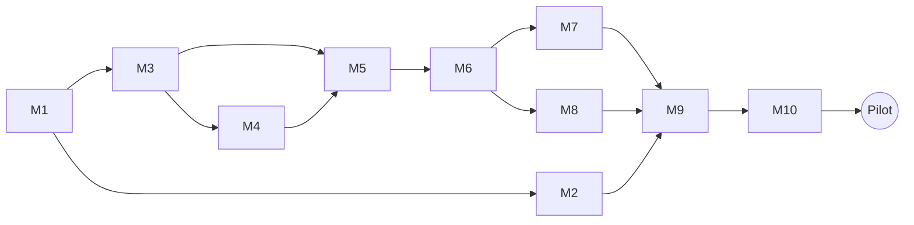

# ROADMAP — Kaynak v1

| | |
| --- | --- |
| Sürüm | v1 (MVP / pilot) · 10 Kasım 2026 · rev. 2 |
| Yapı | 10 kilometre taşı (M1–M10), her biri tek odaklı çalışma oturumunda bitirilebilir ve kendi testiyle kapanır |
| Paralel iz | Pedagoji görevleri (P1–P9), mühendislik taşlarını besler |
| Kurallar | Kapsam `SCOPE.md`, teknik ayrıntı `SPEC.md`, kabul kriterleri `PRD.md`; Claude Code çalışma düzeni `CLAUDE.md` ve `/kilometre-tasi` komutunda |

---

## Genel bakış

| # | Kilometre taşı | Sonunda elinizde ne var | Bağlı olduğu | Pedagoji girdisi |
| --- | --- | --- | --- | --- |
| M1 | İskelet, hesaplar ve canlı ortam | Canlı URL, veritabanına bağlı sağlık kontrolü, tüm sağlayıcı anahtarları | — | — |
| M2 | Giriş, davet ve onam | Davetli kullanıcı Google ile girip rıza verebiliyor | M1 | P8 taslak |
| M3 | Tam şema ve içerik omurgası | Tüm tablolar, RLS, seed edilmiş konu ve hata kodları | M1 | P1, P2, P5 |
| M4 | Teşhis motoru | Testli, saf TypeScript ustalık + teşhis + planlayıcı | M3 (yalnızca kimlikler) | — |
| M5 | Yapay zekâ katmanı | Ölçülmüş maliyet ve gecikmeyle oturum üretimi ve serbest cevap değerlendirme | M3, M4 | P3, P4 |
| M6 | Oturum akışı (metin) | Telefonda baştan sona bir oturum + teşhis kartı | M5 | — |
| M7 | Dinleme | Önbellekli seslendirme, dinle-seç ve dikte | M6 | P9 |
| M8 | Konuşma | Bas-konuş, kelimesi kelimesine transkript, değerlendirme | M6 | P6 |
| M9 | Başlangıç ve ilerleme | Yerleştirme testi, tahmini zayıf noktalar, ilerleme ekranı | M6 (M7, M8 tercihen) | P5 |
| M10 | Yönetim ve pilot hazırlığı | Öğretmen kuyruğu, maliyet paneli, acil durdurma, pilot kapısı | M9 | P8 son |



M2 ile M3–M4 birbirinden bağımsızdır; sıra değiştirilebilir.

---

## M1 — İskelet, hesaplar ve canlı ortam

**Amaç:** Boş ama canlı, dağıtım hattı çalışan bir uygulama; sonraki taşların ihtiyaç duyacağı tüm hesaplar ve anahtarlar hazır.

**Kapsam**
- `create-next-app` (Next.js 16.4, TypeScript, Tailwind 4, App Router), `shadcn` başlatma.
- Repo kökünde `CLAUDE.md`, `.claude/` ve `docs/` (dört belge) yerleştirilir.
- Supabase `dev` ve `prod` projeleri (Frankfurt), Supabase CLI, ilk göç: `cohorts`, `profiles`, `app_settings` (`SPEC.md` Bölüm 3'teki varsayılan değerlerle).
- Vercel projesi (`fra1`), ortam değişkenleri (`SPEC.md` Bölüm 9), PR önizlemeleri `dev`'e.
- Sağlayıcı hesapları (insan işi, Claude Code yapamaz): Anthropic Console (ön ödemeli kredi + aylık harcama limiti 40 $), Azure for Students aboneliği + Speech kaynağı (`northeurope`) + 10 $ bütçe uyarısı, Speechify API (Free plan), Google Cloud OAuth istemcisi. Anahtarlar `.env.local` ve Vercel'e girilir; repoya girmez.
- `GET /api/health` → veritabanına `select 1`.
- Vitest ve `tsx` kurulumu, bir örnek test; kısa README; `.env.example` (değersiz).

**Bitti testi**
- [x] Prod URL açılıyor; `/api/health` → `{ "db": "ok" }`.
- [x] Bir PR açıldığında önizleme URL'si oluşuyor ve `dev` veritabanına bağlanıyor.
- [x] `npm test` yeşil.
- [x] Hiçbir sır istemci paketinde yok (`NEXT_PUBLIC_` dışı değişkenler tarayıcıda görünmüyor); `.env*` dosyaları `.gitignore`'da.
- [x] Üç sağlayıcı anahtarıyla birer "merhaba" çağrısı yerelde çalışıyor (Claude kısa metin, Azure 3 sn'lik WAV, Speechify tek cümle) ve maliyetleri sağlayıcı panellerinde görünüyor. _(11.11.2026: Claude ve transkript OpenRouter üzerinden, Azure yerine MAI-Transcribe-2 Speechify mp3 ile; bkz. SCOPE günlüğü)_

---

## M2 — Giriş, davet ve onam

**Amaç:** Yalnızca davetli öğrenciler girebilsin, rızaları kayıtlı olsun.

**Kapsam**
- Google Cloud OAuth istemcisi + Supabase Google sağlayıcısı; `@supabase/ssr`; `proxy.ts`.
- `/giris`, `/davet/[code]`, `/auth/callback`; yeni kullanıcıda `profiles` satırı (veritabanı tetikleyicisi).
- `onboarding_step` kapısı; `/baslangic/onam` (18+ beyanı + açık rıza); `/gizlilik` taslağı.
- `POST /api/onboarding/invite`, `POST /api/onboarding/consent`.
- `requireUser()`, `requireRole()`; `profiles` ve `cohorts` RLS politikaları.
- `DELETE /api/account` (erken eklemek ucuz, sonradan unutulması pahalı).

**Bitti testi**
- [ ] Davet kodu olmadan giriş yapan kullanıcı onam sayfasına geçemiyor.
- [ ] Kapasite test için 1'e düşürüldüğünde ikinci kullanıcı `409` alıyor.
- [ ] Rıza sürümü ve zamanı `profiles`'ta.
- [ ] İki test kullanıcısıyla RLS: A, B'nin profilini okuyamıyor.
- [ ] Hesap silme sonrası `auth.users` ve `profiles` satırı yok.

---

## M3 — Tam şema ve içerik omurgası

**Amaç:** Bütün veri modeli ve pedagojik içerik veritabanında.

**Kapsam**
- `SPEC.md` Bölüm 3'teki kalan tüm tablolar, indeksler, `check` kısıtları ve RLS politikaları (`llm_usage` önbellek token alanları ve `app_settings`'in rev. 2 anahtarları dahil).
- `item_keys` için öğrenci/öğretmen `select` politikası **yok**.
- Seed: `topics.csv` (32), `l1_codes.csv` (24), `placement.json` (14); `interests` ve `activity-types` sabitleri.
- TypeScript türlerinin üretilmesi (`supabase gen types`).

**Bitti testi**
- [ ] Seed sayıları: 32 konu, 24 kod, 14 yerleştirme sorusu.
- [ ] `L1.LITERAL` dışındaki her `L1.*` kodunun geçerli bir `topic_id`'si var.
- [ ] Öğrenci rolüyle `select * from item_keys` → 0 satır / izin hatası.
- [ ] Supabase Security Advisor'da RLS'i kapalı tablo yok.
- [ ] Pedagoji sahibi konu ve kod listesini onayladı (P1, P2 işaretli).

---

## M4 — Teşhis motoru (saf TypeScript)

**Amaç:** Ürünün kalbi; dil modelinden ve veritabanından bağımsız, tamamen testli.

**Kapsam**
- `lib/engine/`: `types`, `normalize`, `grade-local`, `mastery`, aralıklı tekrar, `diagnosis`, `planner`, `effectiveness` (`SPEC.md` Bölüm 4).
- Planlayıcıda seslendirme kapalı durumu (`SPEC.md` 4.4 adım 8).
- Fikstür tabanlı testler.
- `scripts/simulate.ts`: "yazmada bilen, konuşmada bilmeyen" sentetik öğrenciyle sahte değerlendirme kullanarak 6 oturum.

**Bitti testi** (en az 25 Vitest testi, hepsi yeşil; şunlar zorunlu)
- [ ] Yazma 5/6 + konuşma 1/4 → `skill_gap(speaking)`, güven ≥ 0,6.
- [ ] Tüm ölçülen beceriler ≤ 0,45 ve toplam kanıt ≥ 6 → `topic_gap`.
- [ ] Aynı konu ve beceride bir tür ≤ %35, diğeri ≥ %70 → `activity_mismatch`.
- [ ] Tek cevap bir ustalık puanını en çok 0,25 değiştiriyor; ipuçlu cevap en çok 0,5 sayılıyor.
- [ ] Planlayıcı her çağrıda 8–10 slot, 900–1200 sn, dört beceri ve (uygunsa) ≥ 1 çapraz tekrar üretiyor; `tts_enabled = false` iken dinleme slotu yok.
- [ ] Dikte: hedef "She plays football every day", cevap "She play football every day" → 5 kelimede 1 hata, puan 0,80 → yanlış (eşik 0,9).
- [ ] `simulate.ts`: en geç 5. oturumda güveni ≥ 0,6 `skill_gap(speaking)`.

---

## M5 — Yapay zekâ katmanı ve maliyet koruması

**Amaç:** İçerik üretimi ve serbest cevap değerlendirmesi; her kuruş ve her saniye ölçülü.

**Kapsam**
- `ai` + `@ai-sdk/anthropic`; `lib/ai/schemas.ts` (Zod, `z.record` yok — `SPEC.md` 5.2), `prompts/generate.ts`, `prompts/grade.ts`.
- Çağrı ayarları `SPEC.md` 5.1'e göre: `claude-haiku-5-5`, üretimde `effort = medium`, değerlendirmede `low`; `temperature` gönderilmez; sistem komutu `cacheControl` ile önbellekte.
- Üretim sonrası kod kontrolleri ve slot düzeyinde yeniden üretim; `refusal` durumunun ele alınması.
- `lib/ai/cost.ts` (fiyat tablosu, önbellek fiyatları dahil), `llm_usage` günlüğü, `lib/ai/guard.ts` (acil durdurma, aylık tavan + `tts_plan_usd`, günlük sınır).
- `scripts/eval-generation.ts`, `scripts/eval-tagging.ts` (maliyet ve gecikme raporlu).

**Bitti testi**
- [ ] `eval-generation`: 4 profil × 5 oturum = 20 oturum, yeniden denemeyle %100 şema geçerli, ortalama ≤ 0,02 $/oturum (beklenen ≈ 0,005 $ yalnız üretim), üretim süresi p90 ≤ 60 sn.
- [ ] Pedagoji sahibi 20 oturumdan rastgele 20 etkinliği inceledi: ≥ 18'i seviyeye ve kurallara uygun.
- [ ] `eval-tagging`: 40 cümlelik altın sette öğretmen etiketiyle ≥ %80 uyum. Değilse önce `effort_grade = medium`, yetmezse `model_grade` bir üst modele alınır, test tekrarlanır.
- [ ] `eval-tagging`: değerlendirme p90 ≤ 6 sn. Değilse `thinking_grade = disabled` ile tekrar ölçülür ve uyum yeniden kontrol edilir.
- [ ] İsteklerde `temperature` / `top_p` yok (kod incelemesi); ikinci çağrıdan itibaren `cache_read_tokens > 0`.
- [ ] Guard testleri: `kill_switch = true` → çağrı yok; ay içi maliyet + plan ücreti tavana eşit → çağrı yok; günlük sınır aşılınca üretim yok.
- [ ] `llm_usage` satırlarında komut ya da öğrenci metni yok.

---

## M6 — Oturum akışı (metin etkinlikleri)

**Amaç:** Bir öğrenci telefonundan baştan sona bir oturum yapabilsin ve teşhis kartını görsün.

**Kapsam**
- `POST /api/sessions/next`, `GET /api/sessions/:id`, `start`, `POST /api/items/:id/attempt`, `hint`, `explanation`, `finish` (+ `after()` ile sonraki oturum, `maxDuration = 120`), `diagnoses/:id/feedback`.
- `/oturum/[id]` sayfası, ilerleme çubuğu, beş metin bileşeni: `McqRead`, `GapFill`, `WordOrder`, `Translate`, `ShortWrite`.
- Kaldığı yerden devam; oturum özeti; teşhis kartı; 1–5 puan.
- Geçici bayrak: dinleme ve konuşma slotları bu taşta metin türlerine düşürülür (M7–M8'de kaldırılır; dinleme için aynı mekanizma `tts_enabled` ile kalıcı olur).

**Bitti testi**
- [ ] Gerçek telefonda bir oturum baştan sona tamamlanıyor.
- [ ] Her cevap için `attempts`, gerekiyorsa `error_events`, ve `mastery` satırları yazılıyor.
- [ ] Yerel değerlendirme ≤ 1 sn; yapay zekâ değerlendirmesi p90 ≤ 6 sn.
- [ ] Oturum bittikten sonra 60 sn içinde sonraki oturum `ready`; "Başla" ≤ 2 sn'de açılıyor.
- [ ] Sayfa yenilenince oturum kaldığı etkinlikten devam ediyor.
- [ ] Ağ sekmesinde hiçbir yanıtta cevap anahtarı görünmüyor.

---

## M7 — Dinleme

**Amaç:** Dinleme becerisini ölçen iki etkinlik, yüksek ses kalitesi ve kontrollü maliyetle.

**Kapsam**
- `lib/tts/speechify.ts`: `POST /v1/audio/speech`, `simba-3.5`, mp3, `en-US`; A1 için SSML `prosody rate="-10%"`; metnin XML kaçışı; base64 → `tts/` özel kovası; `sha256(model|voice|rate|text)` önbelleği; imzalı URL; `billable_characters_count` → `llm_usage.tts_chars`.
- Aylık karakter sayacı, `tts_monthly_char_alert` uyarısı; Speechify 402/429'da `tts_unavailable` yanıtı ve dinleme slotlarının metne düşmesi.
- `GET /api/items/:id/audio`; `ListenChoose`, `Dictation` bileşenleri; en çok 3 dinleme sayacı.
- Planlayıcıdaki geçici bayrağın dinleme için `tts_enabled` ayarına bağlanması.

**Bitti testi**
- [ ] Aynı metin ikinci kez istendiğinde TTS çağrılmıyor (`llm_usage`'da tek `tts` satırı).
- [ ] A1 öğrencisinde hız 0,9 (`prosody -10%`), A2'de 1,0; `&` içeren bir metin hatasız seslendiriliyor.
- [ ] Dikte puanlaması M4 testleriyle tutarlı.
- [ ] Speechify yanıtı sahte 402 ile değiştirildiğinde açık oturum kırılmıyor, sonraki oturum dinlemesiz planlanıyor.
- [ ] iOS Safari ve Android Chrome'da ses çalıyor; 4. dinleme engelli.

---

## M8 — Konuşma

**Amaç:** Söz kesmeyen, aksanı cezalandırmayan, öğrenci hatalarını gizlemeyen konuşma etkinliği.

**Kapsam**
- `lib/audio/wav-recorder.ts` (Web Audio API, 16 kHz mono, istemcide örnek azaltma, 45 sn sınırı).
- `SpeakAnswer` bileşeni (bas-başlat / bas-bitir, transkripti göster, 1 yeniden kayıt).
- `lib/stt/mai.ts`: Azure Fast Transcription, `enhancedMode` + `MAI-Transcribe-2`, `locales: ["en"]`, `verbatim` (varsayılan).
- `POST /api/items/:id/speech` (multipart, ≤ 2 MB), iki adım: transkript (Azure) → değerlendirme (Claude).
- MAI-Transcribe-2'nin dosya boyutu/süre sınırlarının ve `northeurope` bölge desteğinin doğrulanması.
- `scripts/eval-verbatim.ts`.
- Planlayıcıdaki geçici bayrağın konuşma için kaldırılması.

**Bitti testi**
- [ ] `eval-verbatim`: pedagoji sahibinin bilerek hatalı okuduğu 20 kayıtta hataların ≥ %85'i transkriptte korunuyor. Değilse `SPEC.md` 5.1'deki yedek sağlayıcı denenir.
- [ ] Aksanlı ama dilbilgisi doğru 10 cevapta aksan nedeniyle puan düşülmüyor.
- [ ] iOS Safari ve Android Chrome'da mikrofon izni ve kayıt çalışıyor; sessizlikte kayıt durmuyor; iOS'ta gönderilen WAV 16 kHz.
- [ ] Ses dosyası Storage'a veya diske yazılmıyor (kod incelemesi + kova kontrolü).
- [ ] Transkript + değerlendirme toplamı p90 ≤ 6 sn.

---

## M9 — Başlangıç akışı ve ilerleme

**Amaç:** Davetten ilk oturuma 10 dakikadan kısa, ilk gün değer gösteren bir başlangıç.

**Kapsam**
- `/baslangic/profil` (seviye beyanı, ilgi alanları).
- `POST /api/placement` (sabit banka, `kind = placement`), ustalık tohumlama, `level_est`.
- "Tahmini zayıf noktalar" kartı, ardından ilk günlük oturumun üretimi.
- `/ilerleme` (ızgara, haftalık sayı, en sık 3 hata) · `POST /api/school-topic` ve haftalık soru · `app/manifest.ts` (PWA).

**Bitti testi**
- [ ] Ekip dışından 3 kişi davet linkinden ilk etkinliğe 10 dakikadan kısa sürede ulaşıyor.
- [ ] Yerleştirmede yapay zekâ çağrısı yalnızca konuşma sorusunda yapılıyor (`llm_usage`).
- [ ] Izgara dört renk seviyesini doğru gösteriyor.
- [ ] Seçilen okul konusu sonraki 2 oturumun planında yer alıyor.
- [ ] Uygulama iki platformda ana ekrana eklenebiliyor; 360 px'te yatay kaydırma yok.

---

## M10 — Yönetim, öğretmen kuyruğu ve pilot hazırlığı

**Amaç:** Pilotu ölçebilen, maliyeti durdurabilen, başlamaya hazır bir sistem.

**Kapsam**
- `/yonetim` özet: kayıtlı/aktif, haftada ≥ 4 oturum oranı, W4, ay içi maliyet (sağlayıcıya göre), oturum başı maliyet, ay içi TTS karakteri, önbellek isabet oranı.
- `/yonetim/inceleme`: kuyruk, karar kaydı, haftalık uyum.
- Ayarlar: acil durdurma, aylık tavan, günlük sınır, model kimlikleri ve `effort` seviyeleri, `tts_enabled`, `tts_plan_usd`.
- `GET /api/cron/daily` + `vercel.json`; `GET /api/account/export`.
- Son gizlilik metni (işleyen sağlayıcılar adıyla); sağlayıcı harcama limitlerinin son kontrolü (Anthropic Console 40 $, Azure bütçe uyarısı, Speechify planı); pilot kohortu ve davet kodu.
- Cihaz kontrol listesi; isteğe bağlı tek Playwright duman testi.

**Bitti testi**
- [ ] Acil durdurma açıkken yeni oturum üretilemiyor; öğrenci nazik mesaj görüyor.
- [ ] Tavan test için 0,01 $'a düşürüldüğünde üretim duruyor ve panelde uyarı çıkıyor.
- [ ] `tts_monthly_char_alert` test için 1'e düşürüldüğünde panelde seslendirme kotası uyarısı çıkıyor.
- [ ] Kuyruk, yapay zekâ etiketli hataların yaklaşık %15'ini içeriyor; sabit veriyle uyum yüzdesi doğru hesaplanıyor.
- [ ] Cron, gizli anahtar olmadan `401` dönüyor.
- [ ] Dışa aktarım JSON'ı öğrencinin tüm tablolardaki kayıtlarını içeriyor.

### Pilot başlatma kapısı

- [ ] `SCOPE.md` "v1 bitti" tanımındaki tüm maddeler işaretli.
- [ ] İç test: ekip + en az 3 arkadaş, 3 gün, engelleyici hata yok.
- [ ] Hukuki görüş alındı; aydınlatma metni yayında.
- [ ] Başarı ölçütü eşikleri (`PRD.md` Bölüm 3) ve fiyat testi ücreti (`PRD.md` Açık soru 1) sabitlendi ve ikisinin de onayıyla yazıldı.
- [ ] Speechify planı kararı verildi: Gerçekçi kullanımda ay sonuna doğru ücretsiz kota bitiyor; ya Starter (10 $/ay) açılır ya da kota dolunca dinlemenin kapanması kabul edilir.

---

## Pedagoji izi (paralel)

| # | Görev | Çıktı | Gerektiği taş |
| --- | --- | --- | --- |
| P1 | Konu listesini doğrula (`SPEC.md` Ek A) | Onaylı `topics.csv` | M3 |
| P2 | Hata kodlarını doğrula, her koda 2 yanlış/doğru örnek ekle (Ek B) | Onaylı `l1_codes.csv` | M3 |
| P3 | Açıklama stil rehberi (1 sayfa) | Komutlara girecek kurallar | M5 |
| P4 | Altın etiket seti: gerçekçi 40 öğrenci cümlesi + doğru kod | `golden.json` | M5 |
| P5 | 14 yerleştirme sorusu | `placement.json` | M3 / M9 |
| P6 | Bilerek hatalı okunmuş 20 ses kaydı + hata listesi | `verbatim/*.wav` | M8 |
| P7 | ChatGPT ile çalışan 10–15 hazırlık öğrencisiyle görüşme | Kısa rapor; eşik: ≥ 6 kişi aynı tıkanmayı anlatıyor | M5'e kadar |
| P8 | Aydınlatma ve açık rıza metni; hukuki görüş | Taslak (M2), son hâli (M10) | M2, M10 |
| P9 | Seslendirme sesi seçimi: Speechify Simba 3.5 en-US seslerinden 2–3 aday, A1 hızında da dinlenir | `tts_voice` değeri | M7 |

P7 sonucu ürünle çelişirse (ör. öğrenciler asıl sorunun başka bir yerde olduğunu söylüyorsa) M6'dan önce kapsam yeniden konuşulur ve `SCOPE.md` günlüğüne yazılır.

---

## Takvim (tahmini)

Bir kilometre taşı = bir odaklı çalışma oturumu (≈ 3–5 saat). Haftada 3–4 oturumla:

| Dönem | Tarih (tahmini) | Ne |
| --- | --- | --- |
| İnşa | 16 Kasım – 6 Aralık 2026 | M1–M10; pedagoji izi paralel |
| İç test | 7 – 13 Aralık 2026 | Ekip + 3 arkadaş, hata düzeltme |
| Pilot | 14 Aralık 2026 – 7 Şubat 2027 (8 hafta) | 50 kişi; haftalık ölçüm; 4. haftada ara değerlendirme |
| Fiyat testi ve rapor | Pilotun son haftası | Ön ödeme isteği; karar: v2 Öncelik 1 |

**Takvim riski:** Pilot dönem sonu sınavlarına ve sömestr tatiline denk geliyor. Sınav dönemi kullanımı artırabilir, tatil düşürebilir. İki seçenek: ölçümleri "tatil öncesi" ve "tatil" diye ayrı raporlamak ya da pilotu bahar dönemi başına kaydırmak. Pilot başlamadan önce karar verin.

---

## Her oturum için çalışma kalıbı (Claude Code)

Repo kökündeki `CLAUDE.md` her oturumda otomatik yüklenir; tek tek taşlar için hazır komut vardır:

```text
/kilometre-tasi M3
```

Komut (`.claude/skills/kilometre-tasi/SKILL.md`) sırasıyla şunları yaptırır: ROADMAP'teki taşı ve ilgili SPEC/PRD bölümlerini okur → önceki testlerin yeşil olduğunu kontrol eder → plan çıkarır ve SPEC'le çelişen her noktayı size sorar → onaydan sonra `m<n>-…` dalında uygular → "Bitti testi" maddelerini tek tek çalıştırıp kanıtıyla raporlar.

Komut kullanılamıyorsa aynı işi şu istem yapar:

```text
docs/ROADMAP.md'deki M<numara> kapsamını uygula; docs/SCOPE.md dışına çıkma.
docs/SPEC.md'deki tablo, alan ve uç nokta adlarını aynen kullan.
Önce plan çıkar ve onayımı bekle. Bir karar SPEC.md ile çelişiyorsa uygulamadan önce bana sor.
Bitirince M<numara> "Bitti testi" maddelerini tek tek çalıştır ve sonucu kanıtıyla raporla.
```

Taş bitince: testler yeşil → yeni bir oturumda diff'i SPEC'e göre bağımsız incelet → `ROADMAP.md`'de kutular işaretli → `SCOPE.md`'de ilgili M maddeleri işaretli → ana dala birleştir.
