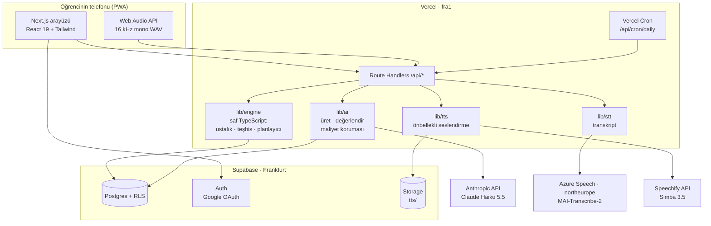

# SPEC — Kaynak v1 teknik spesifikasyonu

| | |
| --- | --- |
| Sürüm | v1 (MVP / pilot) · 10 Kasım 2026 · rev. 2 (model yığını ve maliyet güncellendi) |
| Okuyucu | Mühendis; ayrıca Claude Code gibi kodlama asistanları |
| Bağlam | Ürün kararları `PRD.md`'de, kapsam `SCOPE.md`'de, sıra `ROADMAP.md`'de; maliyet ve fiyat hesabı finans tablosunda (Google Sheets: Özet, Model Seçimi (AA), Oturum Maliyeti, Pilot) |
| Ana kısıt | 50 kişilik pilot, aylık altyapı ≤ 50 €, tek mühendis |

**Mimari karar özeti:** Tek bir Next.js uygulaması (arayüz + API) Vercel'de; veri, kimlik doğrulama ve dosya depolama Supabase'te; dil modeli Anthropic API'de (Claude Haiku 5.5); konuşma tanıma Azure Speech'te (MAI-Transcribe-2); seslendirme Speechify API'de (Simba 3.5). Teşhis motoru saf TypeScript'tir ve dil modelinden bağımsızdır. Ayrı bir arka uç sunucusu, kuyruk sistemi veya vektör veritabanı yoktur.

**Model seçiminin gerekçesi (rev. 2):** Modeller Artificial Analysis karşılaştırmalarıyla "en düşük maliyete en yüksek kalite" ölçüsüyle seçildi. Önceki seçime (Gemini 3.1 Flash-Lite + Chirp 3: HD) göre dört alanda da kalite daha yüksek, oturum başı yapay zekâ maliyeti ≈ %33 daha düşük (0,0176 $ → 0,0118 $). Ayrıntı ve hesap: finans tablosu → Model Seçimi (AA).

| Alan | Seçim | Kalite (Artificial Analysis) | Önceki seçim |
| --- | --- | --- | --- |
| Oturum üretimi | Claude Haiku 5.5, `effort = medium` | Zekâ Endeksi 25 | Gemini 3.1 Flash-Lite: 6 (kullanımdan kalkıyor) |
| Serbest cevap değerlendirme | Claude Haiku 5.5, `effort = low` | Zekâ Endeksi 19 | Gemini 3.1 Flash-Lite: 6 |
| Konuşma transkripti | MAI-Transcribe-2 | Hata oranı (WER) %2,0 | Gemini 3.1 Flash-Lite: %3,4 |
| Seslendirme | Speechify Simba 3.5 | TTS Arena Elo 1286 | Chirp 3: HD: 1062 |

---

## 1. Stack ve sürümler

Sürümler 10 Kasım 2026 itibarıyla güncel kararlı sürümlerdir. Kurulumda `@latest` ile çekip `package.json`'a sabitleyin (`^` yerine tam sürüm).

| Katman | Seçim | Sürüm | Neden |
| --- | --- | --- | --- |
| Çalışma zamanı | Node.js | 26.x LTS | Vercel'de yeni projelerin varsayılanı; `@supabase/supabase-js` Node 20'yi bıraktı |
| Framework | Next.js (App Router, Route Handlers, `after()`) | 16.4.x | Arayüz + API tek repo, tek deploy |
| UI kütüphanesi | React | 19.x (Next ile gelen) | — |
| Dil | TypeScript | `create-next-app` varsayılanı | — |
| Stil | Tailwind CSS | 4.3.x | Yapılandırma dosyası gerektirmez |
| Bileşenler | shadcn/ui (CLI ile kopyalanan bileşenler) | CLI son sürüm | Bağımlılık değil, kaynak kod |
| Veritabanı, Auth, Depolama | Supabase (Postgres + RLS, Auth, Storage) | `@supabase/supabase-js` 2.110.x, `@supabase/ssr` son sürüm, Supabase CLI son sürüm | Ücretsiz katman pilota yeter; tek sağlayıcıda üç ihtiyaç |
| Şema doğrulama | Zod | 4.x | Dil modeli çıktıları ve API girdileri |
| Yapay zekâ SDK'sı | Vercel AI SDK (`ai`) + `@ai-sdk/anthropic` | `ai` 7.0.x + onunla uyumlu son `@ai-sdk/anthropic` | Yapılandırılmış çıktı, istem önbelleği (`cacheControl`) ve `effort` desteği; sağlayıcı değişimi tek satır |
| Dil modeli | Claude Haiku 5.5 (`claude-haiku-5-5`) | GA (7 Ekim 2026), emeklilik en erken 7 Ekim 2027 | 0,10 $/1M girdi, 0,50 $/1M çıktı (düşünme dahil), önbellek okuma 0,01 $/1M; düşünme derinliği `effort` ile |
| Konuşma tanıma | Azure Speech — MAI-Transcribe-2 (Fast Transcription API, `enhancedMode`) | Önizleme (preview), `api-version=2025-10-15`, bölge `northeurope` | En düşük hata oranlarından; 1,67 $/1000 dk; varsayılan çıktı biçimi `verbatim` (öğrenci hatasını düzeltmez) |
| Seslendirme | Speechify API — Simba 3.5 (`simba-3.5`) | REST v1 (`POST /v1/audio/speech`) | En yüksek kalite grubunun en ucuzu; ücretsiz plan 500.000 karakter/ay, sonra Starter 10 $/ay |
| Birim test | Vitest | son sürüm | Teşhis motoru testleri |
| Betik çalıştırıcı | `tsx` (dev bağımlılığı) | son sürüm | `scripts/*.ts` |
| Uçtan uca test | Playwright | son sürüm | İsteğe bağlı, tek duman testi |
| Barındırma | Vercel Hobby, bölge `fra1` | — | Pilot ücretsiz; Supabase Frankfurt'a yakın |
| Kod deposu ve CI | GitHub + Vercel önizleme dağıtımları | — | Her PR'a önizleme URL'si |

**Model notları:**

- Model kimlikleri, `effort` seviyeleri ve ses ayarları `app_settings` tablosunda tutulur; kod değişmeden değiştirilebilir.
- Claude Haiku 5.5 `temperature`, `top_p`, `top_k` parametrelerini ve asistan ön doldurmayı (prefill) **kabul etmez**; gönderilirse API 400 hatası döner. Yanıt bir düşünme bloğuyla başlayabilir; içerik konumuna göre değil türüne göre okunur (AI SDK bunu yapar).
- Düşünme varsayılan olarak uyarlamalıdır (adaptive) ve derinliği `effort` (`low`, `medium`, `high`, `xhigh`, `max`) ile ayarlanır; Haiku 5.5'te varsayılan `medium`. Düşünme `thinking: { type: 'disabled' }` ile `high` ve altında kapatılabilir. Düşünme tokenları `max_tokens`'a dahildir ve çıktı fiyatıyla ücretlenir.
- Haiku 5.5'in tokenizer'ı aynı metni eski modellere göre ≈ %30 daha fazla tokenla sayar. Bu belgedeki token tahminleri bu çarpanla büyütülmüştür.
- Etiketleme kalitesi altın sette %80'in altında kalırsa önce `effort_grade = medium` denenir; yetmezse yalnızca değerlendirme çağrıları bir üst modele taşınır.
- MAI-Transcribe-2 önizleme aşamasındadır: API sürümü ve fiyatı değişebilir. Transkript `lib/stt` arkasında tek arayüzle çağrılır; gerekirse sağlayıcı değiştirilir (Bölüm 5.1).

**Veri kullanım koşulları:** Anthropic Ticari Koşulları, API'ye gönderilen içeriğin model eğitiminde kullanılmasını yasaklar. Azure Speech veriyi kaynağın bölgesinde (`northeurope`, İrlanda) işler. Speechify'a yalnızca sistemin ürettiği İngilizce alıştırma metni gider; öğrenci verisi ve kimliği gitmez.

---

## 2. Mimari



### Temel veri akışı (bir oturum)

1. `finish` çağrısı bir oturumu kapatır → ustalık ve teşhis güncellenir → `after()` ile bir sonraki oturum planlanır ve üretilir (`status = ready`).
2. Öğrenci "Başla"ya basar → hazır oturum anında açılır (dil modeli çağrısı yok).
3. Her cevap `POST /api/items/:id/attempt` (veya `/speech`) ile gönderilir → yerel ya da yapay zekâ değerlendirmesi (konuşmada önce Azure transkript, sonra Claude değerlendirme) → `attempts`, `error_events`, `mastery` güncellenir → kısa geri bildirim döner.
4. Dinleme etkinliği açıldığında `GET /api/items/:id/audio` önbellekte yoksa Speechify ile ses üretir, `tts/` kovasına koyar, imzalı URL döner.

`after()` ile yapılan iş aynı fonksiyon çağrısının süresine dahildir (Vercel Hobby'de üst sınır 300 sn). `finish` uç noktasında `export const maxDuration = 120` tanımlanır.

### Dizin yapısı

```
kaynak/
├─ CLAUDE.md                          # Claude Code proje yönergeleri
├─ .claude/                           # Claude Code ayarları, kurallar, /kilometre-tasi komutu
├─ docs/{PRD,SPEC,SCOPE,ROADMAP}.md
├─ app/
│  ├─ (auth)/giris/page.tsx
│  ├─ (auth)/davet/[code]/page.tsx
│  ├─ auth/callback/route.ts
│  ├─ (onboarding)/baslangic/{onam,profil,yerlestirme}/page.tsx
│  ├─ (app)/page.tsx                  # ana sayfa: bugünkü oturum
│  ├─ (app)/oturum/[id]/page.tsx
│  ├─ (app)/ilerleme/page.tsx
│  ├─ (app)/ayarlar/page.tsx
│  ├─ (yonetim)/yonetim/page.tsx
│  ├─ (yonetim)/yonetim/inceleme/page.tsx
│  ├─ api/…                           # Bölüm 6
│  ├─ gizlilik/page.tsx               # aydınlatma metni
│  └─ manifest.ts                     # PWA
├─ components/
│  ├─ activity/{McqRead,GapFill,WordOrder,ListenChoose,Dictation,Translate,ShortWrite,SpeakAnswer}.tsx
│  └─ ui/                             # shadcn
├─ lib/
│  ├─ engine/{types,mastery,diagnosis,planner,effectiveness,grade-local,normalize}.ts
│  ├─ ai/{client,generate-session,grade,schemas,cost,guard}.ts
│  ├─ ai/prompts/{generate,grade}.ts
│  ├─ stt/{index,mai}.ts              # transkript arayüzü + Azure MAI-Transcribe-2
│  ├─ tts/{speechify,cache}.ts
│  ├─ db/{server,admin}.ts           # kullanıcı istemcisi / servis istemcisi
│  ├─ audio/wav-recorder.ts
│  └─ content/{interests,activity-types}.ts
├─ supabase/
│  ├─ migrations/*.sql
│  ├─ seed.sql
│  └─ seed/{topics.csv,l1_codes.csv,placement.json}
├─ scripts/{eval-generation,eval-tagging,eval-verbatim,simulate}.ts
├─ tests/engine/*.test.ts
└─ proxy.ts                           # Next 16'da middleware'in yeni adı: oturum yenileme + yönlendirme
```

---

## 3. Veri modeli

Tüm zaman alanları `timestamptz`, tüm kimlikler aksi belirtilmedikçe `uuid default gen_random_uuid()`. Öğrenciye ait tüm tablolarda `user_id uuid not null references auth.users(id) on delete cascade` vardır; hesap silme bu zincirle her şeyi siler.

### Sabit kümeler (kodda sabit + veritabanında `check` kısıtı)

| Küme | Değerler |
| --- | --- |
| `skill` | `reading`, `listening`, `writing`, `speaking` |
| `mode` | `recognition`, `controlled`, `free` |
| `activity_type` | `mcq_read`, `gap_fill`, `word_order`, `listen_choose`, `dictation`, `translate_tr_en`, `short_write`, `speak_answer` |
| `purpose` | `placement`, `review`, `focus`, `retest`, `stretch` |
| `role` | `student`, `teacher`, `admin` |
| İlgi alanları (`lib/content/interests.ts`) | `football`, `other_sports`, `gaming`, `music`, `series_film`, `tech`, `social_media`, `fashion`, `food`, `travel`, `science_space`, `cars` |

### Etkinlik türleri (`lib/content/activity-types.ts`)

| Kod | Beceri | Mod | Değerlendirme | `est_seconds` |
| --- | --- | --- | --- | --- |
| `mcq_read` | reading | recognition | local | 100 |
| `gap_fill` | writing | controlled | local | 60 |
| `word_order` | writing | controlled | local | 60 |
| `listen_choose` | listening | recognition | local | 75 |
| `dictation` | listening | controlled | local | 90 |
| `translate_tr_en` | writing | free | llm | 110 |
| `short_write` | writing | free | llm | 180 |
| `speak_answer` | speaking | free | llm_audio | 120 |

### Tablolar

#### `cohorts` — pilot grupları

| Alan | Tür | Not |
| --- | --- | --- |
| id | uuid PK | |
| name | text | "Pilot Kasım 2026" |
| invite_code | text unique | URL'de taşınır |
| capacity | int default 60 | |
| starts_on, ends_on | date | |
| created_at | timestamptz | |

#### `profiles` — öğrenci profili (1:1 `auth.users`)

| Alan | Tür | Not |
| --- | --- | --- |
| id | uuid PK → auth.users(id) on delete cascade | |
| display_name | text | Google adından, düzenlenebilir |
| role | text default 'student' | yalnızca SQL ile değiştirilir |
| cohort_id | uuid → cohorts | |
| level_self | text | `A1`, `A2`, `unsure` |
| level_est | text | yerleştirme sonrası `A1` / `A2` |
| interests | text[] | en az 2 |
| explain_mode | text default 'short' | `short` / `long` |
| adult_confirmed_at | timestamptz | 18+ beyanı; doğum tarihi tutulmaz |
| consent_version, consent_at | text, timestamptz | açık rıza kaydı |
| onboarding_step | text default 'invite' | `invite` → `consent` → `profile` → `placement` → `done` |
| created_at, updated_at | timestamptz | |

#### `topics` — konu listesi (seed, Ek A)

| Alan | Tür | Not |
| --- | --- | --- |
| id | text PK | `g.present_simple_3sg` |
| level | text | `A1` / `A2` |
| kind | text | `grammar` / `pron` |
| title_tr, title_en | text | |
| description_tr | text | 1 cümle |
| l1_risk | smallint 0–2 | Türkçe kaynaklı zorluk; başlangıç ustalığını belirler |
| prereqs | text[] | konu kimlikleri |
| sort | int | |
| active | bool default true | |

#### `l1_codes` — hata sınıflandırması (seed, Ek B)

| Alan | Tür | Not |
| --- | --- | --- |
| code | text PK | `L1.3SG_S`, `GEN.SPELLING` |
| topic_id | text → topics, null olabilir | |
| is_l1 | bool | Türkçe kaynaklı mı |
| name_tr | text | "Üçüncü tekil -s eksikliği" |
| rule_tr | text | 1 cümlelik Türkçe karşılaştırma |
| wrong_example, right_example | text | |

#### `sessions` — oturumlar

| Alan | Tür | Not |
| --- | --- | --- |
| id | uuid PK | |
| user_id | uuid | |
| kind | text | `placement` / `daily` |
| status | text | `ready`, `active`, `done`, `abandoned`, `failed` |
| plan | jsonb | planlayıcının slotları ve gerekçeleri (hata ayıklama için) |
| focus_topic_id | text → topics | |
| created_at, started_at, finished_at | timestamptz | |
| rating | smallint 1–5 | |
| comment | text | ≤ 500 karakter |
| cost_usd | numeric(10,5) default 0 | `llm_usage` toplamı |

İndeks: `(user_id, status)`, `(user_id, finished_at desc)`.

#### `items` — oturumdaki etkinlikler (öğrenciye görünen kısım)

| Alan | Tür | Not |
| --- | --- | --- |
| id | uuid PK | |
| session_id | uuid → sessions on delete cascade | |
| user_id | uuid | |
| position | smallint | |
| topic_id | text → topics | hedef konu |
| activity_type, skill, mode | text | |
| purpose | text | |
| interest | text null | `null` = genel içerik (ilgi alanı etkisini ölçmek için %20) |
| l1_target | text → l1_codes null | |
| payload | jsonb | yönerge, metin, şıklar, karışık kelimeler… (Bölüm 5.2) |
| credited | bool default false | etkinlik verimi hesabında kullanıldı mı |
| created_at | timestamptz | |

#### `item_keys` — cevap anahtarları (yalnızca sunucu okur)

| Alan | Tür | Not |
| --- | --- | --- |
| item_id | uuid PK → items on delete cascade | |
| key | jsonb | doğru cevap, kabul edilen varyantlar, çeldiriciler ve L1 kodları, açıklamalar, ipucu |

Bu tabloda öğrenci ve öğretmen için **hiçbir** RLS `select` politikası yoktur; cevap anahtarı istemciye asla sızmaz.

#### `attempts` — cevaplar

| Alan | Tür | Not |
| --- | --- | --- |
| id | uuid PK | |
| item_id | uuid → items on delete cascade | |
| user_id | uuid | |
| try_no | smallint default 1 | konuşmada en çok 2 |
| response | jsonb | `{choice}` / `{text}` / `{order}` / `{transcript}` |
| is_correct | bool | |
| score | numeric(3,2) | 0–1 |
| time_ms | int | |
| hint_used | bool default false | |
| explain_opened | bool default false | |
| graded_by | text | `local` / `llm` |
| feedback_short_tr | text | |
| explanation_long_tr | text | yapay zekâ ile değerlendirilenlerde saklanır |
| correction | text | |
| created_at | timestamptz | |

Benzersiz: `(item_id, try_no)`.

#### `error_events` — etiketlenmiş hatalar (savunma verisi)

| Alan | Tür | Not |
| --- | --- | --- |
| id | uuid PK | |
| attempt_id | uuid → attempts on delete cascade | |
| user_id | uuid | |
| topic_id | text → topics | |
| skill, activity_type, mode | text | |
| l1_code | text → l1_codes | |
| wrong_span, correction | text | |
| source | text | `distractor` / `llm` / `rule` |
| review_sampled | bool | `source = 'llm'` iken %15 olasılıkla `true` |
| created_at | timestamptz | |

İndeks: `(user_id, l1_code, created_at)`, `(review_sampled) where review_sampled`.

#### `mastery` — kademeli ustalık puanı

| Alan | Tür | Not |
| --- | --- | --- |
| user_id, topic_id, skill | PK | |
| score | numeric(4,3) | 0–1 |
| n | int default 0 | kanıt sayısı |
| correct | int default 0 | |
| last_seen_at | timestamptz | |
| next_review_at | timestamptz | aralıklı tekrar |
| updated_at | timestamptz | |

#### `activity_stats` — etkinlik verimi

| Alan | Tür | Not |
| --- | --- | --- |
| user_id, activity_type | PK | |
| taught_n | int default 0 | gecikmeli tekrarı gelen odak etkinliği sayısı |
| retained_n | int default 0 | tekrarda doğru olanlar |
| updated_at | timestamptz | |

#### `diagnoses` — teşhisler

| Alan | Tür | Not |
| --- | --- | --- |
| id | uuid PK | |
| user_id, topic_id | | |
| kind | text | `skill_gap`, `topic_gap`, `activity_mismatch` |
| weak_skill | text null | |
| weak_activity | text null | |
| confidence | numeric(3,2) | |
| evidence | jsonb | `{ writing: {correct: 5, n: 6, score: 0.70}, speaking: {...} }` |
| message_tr | text | şablondan |
| status | text | `active`, `resolved`, `superseded` |
| shown_at | timestamptz null | |
| user_feedback | text null | `agree` / `disagree` |
| created_at | timestamptz | |

#### `school_topics` — haftalık okul konusu

| Alan | Tür | Not |
| --- | --- | --- |
| user_id, week_start | PK (`date`, pazartesi) | |
| topic_id | text null | `null` = hatırlamıyor |
| created_at | timestamptz | |

#### `teacher_reviews` — öğretmen etiketleri (altın veri)

| Alan | Tür | Not |
| --- | --- | --- |
| id | uuid PK | |
| error_event_id | uuid unique → error_events on delete cascade | |
| reviewer_id | uuid → profiles | |
| verdict | text | `agree`, `fix`, `not_error` |
| corrected_l1_code | text → l1_codes null | |
| note | text | |
| created_at | timestamptz | |

#### `llm_usage` — maliyet günlüğü

| Alan | Tür | Not |
| --- | --- | --- |
| id | bigserial PK | |
| user_id, session_id | uuid null | |
| purpose | text | `generate`, `grade`, `transcribe`, `tts`, `placement` |
| provider, model | text | `anthropic` / `azure` / `speechify` ve model kimliği |
| input_tokens, output_tokens | int | çıktıya düşünme tokenları dahil |
| cache_read_tokens, cache_write_tokens | int default 0 | istem önbelleği |
| audio_seconds | numeric | |
| tts_chars | int | Speechify `billable_characters_count` |
| cost_usd | numeric(10,6) | `lib/ai/cost.ts` fiyat tablosundan |
| latency_ms | int | |
| ok | bool | |
| error | text | |
| created_at | timestamptz | indeks |

İçerik (komut ya da öğrenci metni) bu tabloya **yazılmaz**.

#### `tts_cache`

| Alan | Tür | Not |
| --- | --- | --- |
| hash | text PK | sha256(model + ses + hız + metin) |
| voice, rate | text, numeric | |
| storage_path | text | `tts/<hash>.mp3` |
| chars | int | |
| created_at, last_used_at | timestamptz | |

#### `app_settings`

| Anahtar | Varsayılan | Not |
| --- | --- | --- |
| `kill_switch` | `false` | |
| `monthly_budget_usd` | `40` | yapay zekâ + transkript + seslendirme plan ücreti dahil |
| `daily_session_limit` | `2` | |
| `model_generate`, `model_grade` | `"claude-haiku-5-5"` | |
| `effort_generate` | `"medium"` | |
| `effort_grade` | `"low"` | |
| `thinking_grade` | `"adaptive"` | gecikme hedefi tutmazsa `"disabled"` |
| `model_transcribe` | `"MAI-Transcribe-2"` | |
| `tts_model` | `"simba-3.5"` | |
| `tts_voice` | pedagoji sahibinin seçtiği en-US ses kimliği | `GET /v1/voices` listesinden; pilot boyunca değişmez |
| `tts_enabled` | `true` | `false` → yeni oturumlarda dinleme slotları metin türlerine düşer |
| `tts_plan_usd` | `0` | Speechify aylık plan ücreti (Free 0, Starter 10); bütçe hesabına eklenir |
| `tts_monthly_char_alert` | `400000` | ücretsiz kotanın (500.000) %80'i; aşılınca panelde uyarı |
| `review_sample_rate` | `0.15` | |
| `general_content_rate` | `0.2` | |

#### `events` — ürün analitiği

| Alan | Tür | Not |
| --- | --- | --- |
| id | bigserial PK | |
| user_id | uuid | |
| name | text | `app_open`, `session_start`, `session_resume`, `hint_open`, `explain_open`, `audio_replay`, `rerecord`, `diag_feedback`, `limit_hit` |
| props | jsonb | |
| created_at | timestamptz | |

### Satır düzeyi güvenlik (RLS)

Okumalar kullanıcının oturumuyla (RLS etkin), yazmalar Route Handler içinde kimlik doğrulandıktan sonra servis istemcisiyle yapılır.

| Tablo | Öğrenci | Öğretmen | Admin |
| --- | --- | --- | --- |
| `profiles` | kendi satırı `select`; `update` yalnızca `display_name`, `interests`, `explain_mode` (sunucu üzerinden) | `select` (kendi kohortu) | tümü |
| `topics`, `l1_codes` | `select` | `select` | tümü |
| `sessions`, `items`, `attempts`, `error_events`, `mastery`, `diagnoses`, `school_topics`, `activity_stats`, `events` | kendi satırları `select` | `select` (inceleme için) | tümü |
| `item_keys`, `llm_usage`, `tts_cache` | — | — | `select` (`item_keys` hariç) |
| `teacher_reviews` | — | `select`, `insert` | tümü |
| `app_settings` | — | — | `select`, `update` |
| `cohorts` | — | `select` | tümü |

RLS doğrulama testi (M2): iki test kullanıcısıyla A'nın B'ye ait `sessions`, `attempts`, `mastery` satırlarını okuyamadığı ve `item_keys`'i hiç okuyamadığı SQL ile kontrol edilir.

---

## 4. Algoritmalar

`lib/engine/*` saf fonksiyonlardır: veritabanı ya da ağ çağrısı yapmaz, girdi alır çıktı döner. Bu sayede tümü Vitest ile test edilir.

### 4.1 Kademeli ustalık puanı

```ts
prior(topic) = 0.50 - 0.15 * topic.l1_risk        // 0.50 / 0.35 / 0.20

// her kanıt için (hedef cevap ya da serbest cevaptaki yan kanıt)
o = attempt.score                                  // 0..1
if (attempt.hint_used) o = Math.min(o, 0.5)
alpha = mode === 'recognition' ? 0.15 : 0.25
if (evidence.incidental) alpha *= 0.5              // hedef dışı yan kanıt
m = m + alpha * (o - m)                            // |Δm| ≤ 0.25
n += 1
```

Dört renk seviyesi (ilerleme ızgarası): `n = 0` bilinmiyor · `m < 0.45` zayıf · `0.45–0.7` gelişiyor · `≥ 0.7` sağlam.

### 4.2 Aralıklı tekrar

```ts
interval = !correct      ? 1 gün
         : m < 0.50      ? 1 gün
         : m < 0.70      ? 3 gün
         : m < 0.85      ? 7 gün
         :                 14 gün
next_review_at = now + interval
```

### 4.3 Teşhis kuralları

Oturum bitiminde, oturumda dokunulan her konu için çalışır. `S` = bu konuda `n ≥ 3` olan beceriler.

```ts
// 1) Beceri eksiği: konu bir beceride oturmuş, diğerinde değil
if (S.length >= 2) {
  hi = argmax(m over S); lo = argmin(m over S); gap = m[hi] - m[lo]
  if (gap >= 0.30 && m[hi] >= 0.65 && m[lo] <= 0.45)
    → skill_gap(weak = lo)
      confidence = clamp((gap - 0.15) / 0.25) * min(1, n[lo] / 4)
}
// 2) Konu eksiği: her yerde zayıf
else-if (S.length >= 2 && all(m <= 0.45) && sum(n) >= 6)
    → topic_gap
      confidence = clamp((0.55 - mean(m)) / 0.25) * min(1, sum(n) / 8)
// 3) Etkinlik uyumsuzluğu: aynı konu+beceride bir tür tutmuyor, diğeri tutuyor
else-if (bir beceride, n ≥ 3 olan iki tür için: min başarı ≤ 0.35 ve max ≥ 0.70)
    → activity_mismatch(weak_activity)
      confidence = clamp((max - min - 0.20) / 0.30) * min(1, n_min / 4)
// 4) Belirsiz
else → kaydedilmez; planlayıcı en az ölçülen becerede çapraz tekrar koyar
```

- Güven ≥ 0,6 ise teşhis `active` olur ve oturum sonunda gösterilir; aynı konudaki eski aktif teşhis `superseded` olur.
- Zayıf beceri `m ≥ 0.65`'e çıkınca teşhis `resolved` olur ve öğrenciye "çözüldü" kartı gösterilir.

**Örnek (birim testi):** L1 riski 1 olan konu, başlangıç 0,35. Yazma cevapları 1,1,1,1,0,1 → m ≈ 0,70. Konuşma 0,0,1,0 → m ≈ 0,30. Fark 0,40 → `skill_gap(speaking)`, güven ≈ 1,0.

**Mesaj şablonları** (dil modeli çağrısı yok):

| Tür | Şablon |
| --- | --- |
| `skill_gap` | "{konu} konusunu biliyorsun: {güçlü_beceri} etkinliklerinde {d}/{n} doğru. Zorlandığın yer {zayıf_beceri}: {d2}/{n2}. Önümüzdeki oturumlarda {konu}'yu {zayıf_beceri} ile çalışacağız." |
| `topic_gap` | "{konu} henüz oturmamış: tüm becerilerde toplam {d}/{n}. Konuyu baştan, kısa adımlarla ele alacağız." |
| `activity_mismatch` | "{konu}: {zayıf_etkinlik} türünde {d}/{n}, {güçlü_etkinlik} türünde {d2}/{n2}. Sende {güçlü_etkinlik} daha iyi işliyor; ona ağırlık vereceğiz." |

### 4.4 Oturum planlayıcısı

Hedef: 8–10 etkinlik, `est_seconds` toplamı 900–1200 sn, dört beceri en az birer kez.

```text
açık konular = level ≤ level_est olan aktif konular
  (level_est: A2 beyanı veya yerleştirmede ≥ %60 doğru → A2; yoksa A1)

1. Tekrar (1): next_review_at ≤ şimdi olan en eski (konu, beceri); yoksa atla.
2. Odak konusu F = argmax öncelik(t):
     öncelik = (1 − min_beceri_ustalığı(t))
             + 0.15 × l1_risk
             + 0.20 × [t bu haftanın okul konusu]
             + 0.10 × [t üzerinde aktif teşhis var]
   F için 3 etkinlik, en az 2 farklı beceri.
   skill_gap varsa: 2 etkinlik zayıf beceriden.
   Beceri içinde etkinlik türü: ε-greedy (ε = 0.2), skor = (retained_n + 1) / (taught_n + 2).
3. Çapraz tekrar (2): belirsiz konular veya son 3 günde hata yapılan konular;
   en az ölçülmüş beceride ve hatanın yapıldığı beceriden FARKLI bir beceride.
4. Kapsama: dinleme ya da konuşma yoksa F veya tekrar konusundan ekle.
5. Germe (1): önkoşulları m ≥ 0.6 olan, n = 0 sonraki konu.
6. Süre ayarı: > 1200 sn → önce germe, sonra tekrar çıkar; < 900 sn → çapraz tekrar ekle.
7. İlgi alanı: etkinliklere öğrencinin ilgi alanları sırayla atanır;
   general_content_rate (%20) oranında interest = null (genel içerik).
8. Seslendirme kapalıysa (tts_enabled = false): dinleme slotları aynı konu ve
   moddaki metin türüne düşer (listen_choose → mcq_read, dictation → gap_fill);
   bu durumda dört beceri kuralı dinleme hariç uygulanır.
```

Planlayıcı çıktısı slot listesidir: `{position, topic_id, skill, activity_type, purpose, l1_target, interest}`. Bu liste `sessions.plan`'a gerekçeleriyle yazılır, sonra içerik üreticiye verilir.

### 4.5 Etkinlik verimi

```text
purpose = 'retest' olan bir cevap r geldiğinde (konu T):
  f = aynı öğrencinin T üzerindeki en son 'focus' etkinliği,
      r'den en az 48 saat önce, credited = false, f.activity_type ≠ r.activity_type
  f varsa:
    activity_stats[f.activity_type].taught_n += 1
    activity_stats[f.activity_type].retained_n += r.is_correct ? 1 : 0
    f.credited = true
```

### 4.6 Yerel değerlendirme

| Tür | Kural | Hata etiketi |
| --- | --- | --- |
| `mcq_read`, `listen_choose` | `choice === key.correct` | seçilen şıkkın `key.distractors` içindeki kaydının `code` alanı, `source = distractor` |
| `gap_fill` | normalize edilmiş cevap `key.accepted` içinde | `key.wrong_patterns` eşleşirse o kod; yoksa `item.l1_target` ya da `GEN.OTHER` |
| `word_order` | dizilen kelimeler `key.accepted` içindeki bir sıralamayla aynı | `item.l1_target` (çoğu zaman `L1.WORD_ORDER_SOV` / `L1.Q_INVERSION`) |
| `dictation` | kelime düzeyi Levenshtein: `score = max(0, 1 − WER)`, `≥ 0.9` doğru | eksik/yanlış kelime `key.target_words` içindeyse `item.l1_target`; değilse `GEN.OTHER` |

Normalizasyon (`normalize.ts`): küçük harf, baş/son boşluk, çoklu boşluk tek, kıvrık kesme işareti düz, sondaki noktalama yok sayılır, kısaltma eşdeğerleri (`don't` ↔ `do not`, `I'm` ↔ `I am` …).

---

## 5. Yapay zekâ katmanı

### 5.1 Çağrılar

| Çağrı | Ne zaman | Sağlayıcı / ayar | Girdi | Çıktı şeması |
| --- | --- | --- | --- | --- |
| Oturum üretimi | Oturum bitince (`after()`) ve başlangıç sonunda | Anthropic · `model_generate`, `effort_generate` (medium) | planlayıcı slotları, seviye, ilgi alanları, açıklama modu, ilgili L1 kodlarının kısa listesi | `SessionGen` |
| Serbest cevap değerlendirme | `translate_tr_en`, `short_write` cevabında | Anthropic · `model_grade`, `effort_grade` (low), `thinking_grade` | etkinlik, model cevap, öğrenci metni (sınırlayıcılar içinde), konu ve L1 kod listesi | `GradeResult` |
| Transkript | `speak_answer` kaydında | Azure Speech · `model_transcribe` (MAI-Transcribe-2) | WAV ses; `locales: ["en"]`; `transcribeStyle` varsayılanı `verbatim` | `{ transcript: string, unclear: boolean }` (`unclear` = boş ya da çok kısa transkript) |
| Konuşma değerlendirme | transkriptten sonra | Anthropic · `model_grade`, `effort_grade` | transkript + etkinlik | `GradeResult` |

Ayrı bir "uzun açıklama" çağrısı yoktur: yerel değerlendirilen etkinliklerin uzun açıklaması üretim anında `item_keys`'e, yapay zekâ ile değerlendirilenlerinki `GradeResult` içinde gelir. "Daha fazla açıkla" maliyetsizdir.

Transkript ve değerlendirme bilerek **iki ayrı adımdır** (ve iki ayrı sağlayıcıdadır): tek adımda bir model, değerlendirmesine uysun diye transkripti düzeltme eğilimi gösterebilir. `verbatim` biçim dolgu seslerini ve kendini düzeltmeleri korur; öğrencinin dilbilgisi hatasını koruyup korumadığı M8'de `eval-verbatim` ile ölçülür. Sadakat %85'in altında kalırsa ya da önizleme hizmeti kesilirse `lib/stt` arkasında talimat verilebilen bir çok kipli modele (ör. bir Gemini Flash modeli, "kelimesi kelimesine yaz, düzeltme" komutuyla) geçilir.

**Dil modeli çağrı ayarları:**

- `temperature`, `top_p`, `top_k` ve ön doldurma **gönderilmez** (Haiku 5.5 kabul etmez). Çeşitlilik, komuttaki ilgi alanı, konu ve oturuma özgü bir `variety_seed` ile sağlanır.
- `effort`: üretimde `medium`, değerlendirmede `low` (`providerOptions.anthropic.effort`). Değerlendirmede p90 gecikme 6 sn'yi aşarsa `thinking_grade = "disabled"` ile kapatılır.
- `max_tokens` düşünme tokenlarını da kapsar: üretimde 16.000, değerlendirmede 3.000. Fazla düşük değer, düşünme bloğundan sonra boş cevaba yol açar.
- Zaman aşımı: üretim 120 sn (arka planda çalışır), değerlendirme 20 sn, transkript 15 sn; bir kez yeniden deneme.
- `stop_reason: "refusal"` gelirse: üretimde ilgili slot çıkarılır (oturum ≥ 8 etkinlik kalmalı), değerlendirmede öğrenciye "Bu cevabı şu an değerlendiremedik" gösterilir ve ustalık güncellenmez.

### 5.2 Şemalar (Zod, `lib/ai/schemas.ts`)

```ts
const L1Code = z.enum([...L1_CODES])        // Ek B'deki 24 kod
const TopicId = z.enum([...TOPIC_IDS])      // Ek A'daki 32 konu

const GeneratedItem = z.object({
  slot: z.number().int(),
  activity_type: ActivityType,
  topic_id: TopicId,
  payload: z.object({
    instruction_tr: z.string().max(140),
    text_en: z.string().max(600).optional(),      // okuma/dinleme metni
    question_en: z.string().max(160).optional(),
    options: z.array(z.string().max(80)).min(3).max(4).optional(),
    tokens: z.array(z.string()).min(3).max(14).optional(),   // word_order, karışık
    source_tr: z.string().max(160).optional(),    // translate_tr_en
    prompt_en: z.string().max(200).optional(),    // short_write / speak_answer
  }),
  key: z.object({
    correct: z.string().optional(),                // mcq / listen_choose: doğru şıkkın metni
    accepted: z.array(z.string()).optional(),
    distractors: z.array(z.object({                // her yanlış şık için bir kayıt
      option: z.string(),
      code: L1Code,
      feedback_tr: z.string().max(200),
    })).optional(),
    wrong_patterns: z.array(z.object({ answer: z.string(), code: L1Code })).optional(),
    target_words: z.array(z.string()).optional(),
    model_answer_en: z.string().optional(),
    explanation_short_tr: z.string().max(220),     // ≤ 2 cümle
    explanation_long_tr: z.string().max(700),
    hint_tr: z.string().max(140),
  }),
})
const SessionGen = z.object({ items: z.array(GeneratedItem).min(8).max(10) })

const GradeResult = z.object({
  is_correct: z.boolean(),
  score: z.number().min(0).max(1),
  corrected: z.string(),
  feedback_short_tr: z.string().max(220),
  explanation_long_tr: z.string().max(700),
  errors: z.array(z.object({
    span: z.string(), correction: z.string(), l1_code: L1Code, topic_id: TopicId,
  })).max(5),
  evidence: z.array(z.object({ topic_id: TopicId, correct: z.boolean() })).max(6),
})
```

**Yapılandırılmış çıktı notları (rev. 2):**

- Anthropic'in katı JSON şeması serbest anahtarlı nesneleri (`z.record`) desteklemez. Bu yüzden önceki `distractor_codes` / `distractor_feedback_tr` sözlükleri tek bir `distractors` dizisine çevrildi; `correct` yalnızca metin.
- `max`, `min`, `maxLength` gibi sınırlar istekteki şemadan açıklamaya taşınır; cevap geldikten sonra Zod doğrulaması bu sınırları yine uygular.
- Şema karmaşıklık sınırı (istek başına en çok 24 isteğe bağlı alan, 16 `anyOf`) aşılırsa API "Schema is too complex" hatası döner; bu durumda AI SDK'da `structuredOutputMode: 'jsonTool'` kullanılır.
- Şema değişirse istem önbelleği geçersiz olur; şema sabit tutulur.

**Üretim sonrası kod kontrolleri** (şemadan geçse de): `options` doğru cevabı tam bir kez içerir; `tokens` `accepted[0]`'ın bir permütasyonudur; cümle uzunluğu A1 ≤ 12, A2 ≤ 16 kelime; `distractors` her yanlış şık için tam bir kayıt içerir. Geçmeyen slot bir kez yeniden üretilir; yine geçmezse çıkarılır (oturum ≥ 8 etkinlik kalmalı).

### 5.3 Komut ilkeleri (`lib/ai/prompts/*`)

- Sistem komutu sabit ve uzundur (taksonomi, stil rehberi, kurallar) ve `providerOptions.anthropic.cacheControl = { type: 'ephemeral' }` ile önbelleğe işaretlenir; öğrenciye özgü kısım sondadır. Haiku 5.5'te önbelleklenebilir en kısa istem 512 tokendır. Önbellekten okuma girdi fiyatının onda biri (0,01 $/1M), 5 dakikalık önbellek yazma 1,25 katıdır (0,125 $/1M). Maliyet modeli önbellek isabetini muhafazakâr biçimde %0 varsayar; gerçek isabet `llm_usage.cache_read_tokens` ile izlenir.
- Öğrenci metni `<student_answer>…</student_answer>` içinde veri olarak verilir; içindeki talimatlar yok sayılır.
- Değerlendirme kuralları: noktalama ve büyük harf hata sayılmaz; aksan ve telaffuz yorumlanmaz; yalnızca gerçekten kullanılan yapılar için `evidence` üretilir; hata gerçekten Türkçe kaynaklıysa `L1.*`, değilse `GEN.*` kodu.
- Açıklama stili: "sen" dili, yargısız, önce doğru biçim, sonra Türkçeyle tek cümlelik karşılaştırma.
- İçerik kuralları: `PRD.md` Bölüm 8.

### 5.4 Maliyet koruması (`lib/ai/guard.ts`)

Her yapay zekâ, transkript ve TTS çağrısından önce sırayla:

1. `kill_switch = true` → reddet.
2. Ay içi `sum(llm_usage.cost_usd) + tts_plan_usd ≥ monthly_budget_usd` → reddet, yöneticiye panelde uyarı.
3. Oturum üretimi için: öğrencinin bugün başlattığı oturum sayısı `≥ daily_session_limit` → reddet.

Her çağrıdan sonra `llm_usage`'a bir satır yazılır; `sessions.cost_usd` güncellenir.

**Seslendirme kotası:** Speechify ücretsiz planı kota dolunca isteği reddeder. Ay içi `sum(llm_usage.tts_chars) ≥ tts_monthly_char_alert` olunca panelde "Starter'a geçme kararı" uyarısı çıkar. Speechify 402 veya 429 dönerse `tts_enabled = false` gibi davranılır: yeni oturumlarda dinleme slotları metin türlerine düşer (Bölüm 4.4 adım 8), açık bir dinleme etkinliği "Ses şu an kullanılamıyor" mesajıyla atlanır ve ustalık güncellenmez.

---

## 6. API uç noktaları

Tümü Next.js Route Handler. Gövde ve yanıt JSON; girdiler Zod ile doğrulanır. Hata yanıtı: `{ error: { code, message_tr } }`.

### Kimlik ve başlangıç

| Yöntem | Yol | Rol | Girdi | Çıktı |
| --- | --- | --- | --- | --- |
| GET | `/auth/callback` | — | `code` | oturum çerezini kurar, yönlendirir |
| POST | `/api/onboarding/invite` | öğrenci | `{ code }` | `{ ok, cohortName }` · kapasite doluysa `409` |
| POST | `/api/onboarding/consent` | öğrenci | `{ adult: true, consentVersion }` | `{ ok }` |
| POST | `/api/onboarding/profile` | öğrenci | `{ levelSelf, interests: string[≥2] }` | `{ ok }` |
| POST | `/api/placement` | öğrenci | — | `{ sessionId }` sabit bankadan yerleştirme oturumu |

### Oturum ve etkinlikler

| Yöntem | Yol | Rol | Girdi | Çıktı |
| --- | --- | --- | --- | --- |
| POST | `/api/sessions/next` | öğrenci | — | `{ sessionId, status }` · hazır oturum varsa onu, yoksa üretir; koruma kontrolleri |
| GET | `/api/sessions/:id` | sahibi | — | `{ session, items (anahtarsız), attempts }` |
| POST | `/api/sessions/:id/start` | sahibi | — | `{ ok }` |
| POST | `/api/items/:id/attempt` | sahibi | `{ response, timeMs, hintUsed }` | `{ attemptId, isCorrect, score, feedbackShortTr, correction }` |
| POST | `/api/items/:id/speech` | sahibi | `multipart`: `audio` (WAV ≤ 2 MB, ≤ 45 sn), `timeMs`, `tryNo` | `{ attemptId, transcript, isCorrect, score, feedbackShortTr, correction }` |
| GET | `/api/items/:id/hint` | sahibi | — | `{ hintTr }` |
| GET | `/api/attempts/:id/explanation` | sahibi | — | `{ explanationLongTr }` · `explain_opened = true` |
| GET | `/api/items/:id/audio` | sahibi | — | `{ url }` 1 saatlik imzalı URL · seslendirme kullanılamıyorsa `503` + `{ error: { code: 'tts_unavailable' } }` |
| POST | `/api/sessions/:id/finish` | sahibi | `{ rating?, comment? }` | `{ summary, diagnosis? }` · sonraki oturum `after()` ile üretilir (`maxDuration = 120`) |
| POST | `/api/diagnoses/:id/feedback` | sahibi | `{ feedback: 'agree' \| 'disagree' }` | `{ ok }` |

### İlerleme ve hesap

| Yöntem | Yol | Rol | Girdi | Çıktı |
| --- | --- | --- | --- | --- |
| GET | `/api/progress` | öğrenci | — | `{ grid, weekSessions, topErrors, diagnoses }` |
| POST | `/api/school-topic` | öğrenci | `{ topicId \| null }` | `{ ok }` |
| GET | `/api/account/export` | öğrenci | — | JSON dosyası (tüm kişisel kayıtlar) |
| DELETE | `/api/account` | öğrenci | `{ confirm: "SİL" }` | `{ ok }` · `auth.admin.deleteUser` → zincirleme silme |

### Yönetim

| Yöntem | Yol | Rol | Girdi | Çıktı |
| --- | --- | --- | --- | --- |
| GET | `/api/admin/overview` | teacher, admin | — | kayıtlı/aktif kullanıcı, haftada ≥ 4 oturum oranı, W4, ay içi maliyet (sağlayıcıya göre), oturum başı maliyet, ay içi TTS karakteri, önbellek isabet oranı |
| GET | `/api/admin/review-queue` | teacher, admin | `?limit=20` | incelenmemiş `review_sampled` hatalar + bağlam |
| POST | `/api/admin/reviews` | teacher, admin | `{ errorEventId, verdict, correctedL1Code?, note? }` | `{ ok }` |
| GET | `/api/admin/review-stats` | teacher, admin | — | haftalık uyum yüzdesi, koda göre kırılım |
| GET, PATCH | `/api/admin/settings` | admin | `{ key, value }` | ayarlar |
| GET | `/api/cron/daily` | Vercel Cron (`Authorization: Bearer CRON_SECRET`) | — | `{ ok }` |

**Günlük cron işi:** 72 saatten eski `ready` oturumları yeniden planla işaretle; 24 saatten eski `active` oturumları `abandoned` yap; 21 gündür kullanılmayan TTS dosyalarını sil; günlük maliyet özetini hesapla. (Supabase ücretsiz projelerinin 7 gün hareketsizlikte durmasını da önler.)

---

## 7. Kimlik doğrulama ve yetkilendirme

- **Sağlayıcı:** Supabase Auth, yalnızca Google OAuth. E-posta ile giriş v1'de yok (Supabase'in yerleşik e-posta gönderimi düşük limitli; ayrı SMTP maliyet ve iş demek).
- **Google tarafı:** Google Cloud'da OAuth istemcisi; kapsamlar yalnızca `openid email profile` (hassas kapsam olmadığı için uygulama doğrulaması gerekmez). Bu Google Cloud projesinde faturalandırma gerekmez.
- **Oturum:** `@supabase/ssr` ile çerez tabanlı. `proxy.ts` her istekte oturumu yeniler; giriş yapmamış kullanıcıyı `/giris`'e yönlendirir.
- **Davet:** `/davet/[code]` kodu çereze yazar → Google girişi → callback sonrası `POST /api/onboarding/invite`.
- **Başlangıç kapısı:** `(app)` düzeninde sunucu tarafında `profiles.onboarding_step !== 'done'` ise ilgili adıma yönlendirme.
- **Roller:** `profiles.role`; Route Handler'larda `requireUser()` ve `requireRole('teacher' | 'admin')` yardımcıları. Rol ataması yalnızca SQL ile.
- **Sırlar:** Supabase servis anahtarı, Anthropic, Azure Speech ve Speechify anahtarları yalnızca sunucuda; `NEXT_PUBLIC_` önekli tek değerler Supabase URL'si ve yayınlanabilir anahtardır.

---

## 8. Üçüncü taraf servisler

| Servis | Kullanım | Plan | Aylık maliyet (pilot, Gerçekçi) | Sınır / not |
| --- | --- | --- | --- | --- |
| Vercel | Barındırma, fonksiyonlar, cron | Hobby | 0 $ | Hobby yalnızca ticari olmayan kullanım içindir: ücretsiz pilot uygun; ücret alınmadan önce Pro (20 $/ay). Cron günde 1 kez. Fonksiyon süresi en çok 300 sn, istek gövdesi en çok 4,5 MB. |
| Supabase | Postgres, Auth, Storage | Free (2 proje: `dev`, `prod`) | 0 $ | 500 MB veritabanı, 1 GB dosya, 5 GB çıkış trafiği, 50.000 aylık aktif kullanıcı; 7 gün hareketsizlikte durur |
| Anthropic API | Oturum üretimi, değerlendirme (Claude Haiku 5.5) | Kullandıkça öde (ön ödemeli kredi) | ≈ 7,7 $ | Console'da aylık harcama limiti 40 $ |
| Azure Speech | Konuşma transkripti (MAI-Transcribe-2) | Kullandıkça öde; Azure for Students aboneliği (öğrenci e-postasıyla 100 $ kredi, kart gerekmez, 12 ay) | ≈ 2,6 $ (krediden düşer) | Kaynak bölgesi `northeurope` (AB'de MAI-Transcribe'ın tek bölgesi); önizleme hizmeti |
| Speechify API | Dinleme seslendirme (Simba 3.5) | Free (500.000 karakter/ay); gerekirse Starter (10 $/ay, 1,9M karakter, aşım 10 $/1M) | 0–10 $ | Free planda kota dolunca istek reddedilir; Gerçekçi senaryo ≈ 607.000 karakter/ay → Starter gerekir |
| Google Cloud OAuth | Google ile giriş | — | 0 $ | |
| GitHub | Kod, PR | Free | 0 $ | |
| Alan adı | İsteğe bağlı | — | 0 $ (pilotta `*.vercel.app`) | Yayın öncesi ≈ 1 $/ay (Cloudflare, ≈ 10,46 $/yıl) |

### Maliyet modeli

Fiyatlar: Claude Haiku 5.5 0,10 $ / 1M girdi token, 0,50 $ / 1M çıktı token (düşünme dahil); MAI-Transcribe-2 1,67 $ / 1000 dk; Speechify Simba 3.5 kota sonrası ≈ 6,58 $ / 1M karakter (birim ekonomi), aylık toplamda plan basamakları uygulanır. Token tahminleri önceki SPEC profilinin ×1,3'üdür (tokenizer farkı). Aynı hesap finans tablosunun "Oturum Maliyeti" sayfasında formülle durur; girdiler değişince orası güncellenir.

**Tipik oturum (10 etkinlik: 6 yerel, 2 yazma, 2 konuşma):**

| Çağrı | Adet | Girdi | Çıktı (düşünme dahil) | Maliyet |
| --- | --- | --- | --- | --- |
| Oturum üretimi (`medium`) | 1 | 6.500 tok | 6.500 + 2.000 tok | 0,00490 $ |
| Yazma değerlendirme (`low`) | 2 | 2.340 tok | 650 + 300 tok | 0,00142 $ |
| Transkript (≈ 40 sn, %20 yeniden kayıt) | 2,4 | 0,67 dk | — | 0,00267 $ |
| Konuşma değerlendirme (`low`) | 2,4 | 2.340 tok | 650 + 300 tok | 0,00170 $ |
| Yeniden deneme payı (%10) | — | — | — | 0,00107 $ |
| Yerel değerlendirme, ipucu, uzun açıklama | — | — | — | 0 $ |
| **Yapay zekâ toplamı** | | | | **≈ 0,0118 $** (PRD hedefi ≤ 0,02 $) |
| Seslendirme (≈ 700 karakter) | — | — | — | 0 $ kota içinde; kota sonrası ≈ 0,0046 $ |
| **Toplam (marjinal seslendirme dahil)** | | | | **≈ 0,0164 $ ≈ 0,82 TL** |

Yerleştirme testi kişi başı bir kez ≈ 0,0014 $ (yalnızca konuşma sorusu).

**Aylık senaryolar (50 kişi, pilot):**

| Senaryo | Oturum/ay | Yapay zekâ + transkript | Seslendirme | Toplam | Euro |
| --- | --- | --- | --- | --- | --- |
| Düşük katılım (%60 aktif, haftada 2) | ≈ 260 | ≈ 3,1 $ | 0 $ (kota içinde) | ≈ 3,1 $ | ≈ 2,8 € |
| Gerçekçi (haftada 4) | ≈ 870 | ≈ 10,3 $ | 10 $ (Starter) | ≈ 20,3 $ | ≈ 18 € |
| Yoğun (günde 1) | ≈ 1.520 | ≈ 17,9 $ | 10 $ (Starter) | ≈ 27,9 $ | ≈ 25 € |
| Tavan (günde 2, herkes) | ≈ 3.030 | ≈ 35,7 $ | ≈ 12,2 $ | 40 $'da kesilir | ≈ 36 € |

Pilotun iki aylık toplamı (Gerçekçi) ≈ 36 €. Sabit maliyet pilotta 0 $. Uygulama içi tavan (40 $ ≈ 36 €) aylık 50 € bütçenin altında kalır ve Anthropic Console limitinden önce devreye girer.

**Seslendirmede tatlı nokta:** Gerçekçi senaryo Speechify'ın ücretsiz kotasını ≈ %20 aşar ve 10 $/ay Starter gerektirir. Önceki seçim Chirp 3: HD pilotta ücretsizdi ama kalitesi belirgin düşüktü (Elo 1062 / 1286); ayda ≈ 1,33M karakterin (≈ 1.900 oturum) üstünde Simba daha ucuzdur. Oturum başı seslendirilen metin ≈ 575 karakterin altına inerse ya da TTS önbellek isabeti artarsa pilot ücretsiz kotada kalır.

Ücretli döneme ait sabit giderler, fiyat senaryoları ve başabaş hesabı finans tablosundadır (Özet, Fiyat Senaryoları, Kâr-Zarar).

---

## 9. Ortam değişkenleri

| Değişken | Nerede | Açıklama |
| --- | --- | --- |
| `NEXT_PUBLIC_SUPABASE_URL` | istemci + sunucu | |
| `NEXT_PUBLIC_SUPABASE_PUBLISHABLE_KEY` | istemci + sunucu | yayınlanabilir anahtar |
| `SUPABASE_SECRET_KEY` | yalnızca sunucu | servis istemcisi |
| `ANTHROPIC_API_KEY` | yalnızca sunucu | aylık harcama limiti tanımlı çalışma alanının anahtarı |
| `AZURE_SPEECH_KEY` | yalnızca sunucu | Speech kaynağı anahtarı |
| `AZURE_SPEECH_ENDPOINT` | yalnızca sunucu | `https://<kaynak-adı>.cognitiveservices.azure.com` (bölge `northeurope`) |
| `SPEECHIFY_API_KEY` | yalnızca sunucu | |
| `CRON_SECRET` | yalnızca sunucu | |
| `APP_URL` | sunucu | OAuth dönüşü |
| `CONSENT_VERSION` | sunucu | ör. `2026-11-pilot-v1` |

---

## 10. Ses ayrıntıları

**Kayıt (`lib/audio/wav-recorder.ts`):** Web Audio API ile 16 kHz mono PCM → WAV. Gerekçe: tarayıcıların `MediaRecorder` çıktısı farklıdır (Chrome WebM/Opus, Safari MP4/AAC); MAI-Transcribe WAV, MP3 ve FLAC kabul eder ve WAV her tarayıcıda aynı üretilir. iOS Safari `AudioContext`'i çoğu zaman 44,1 veya 48 kHz'de açar ve istenen örnekleme hızını yok sayar; kaydedici 16 kHz'e kendisi örnek azaltır (downsample). Mikrofon ve ses çalma yalnızca bir kullanıcı dokunuşundan sonra başlatılır. 45 sn ≈ 1,4 MB, Vercel fonksiyon gövde sınırının (4,5 MB) altında. Kayıt sunucuda bellekte işlenir ve Azure'a `multipart/form-data` olarak iletilir; diske ya da Storage'a yazılmaz. M8'de MAI-Transcribe-2'nin dosya boyutu ve süre sınırları doğrulanır.

**Transkript isteği (`lib/stt/mai.ts`):**

```text
POST {AZURE_SPEECH_ENDPOINT}/speechtotext/transcriptions:transcribe?api-version=2025-10-15
Ocp-Apim-Subscription-Key: {AZURE_SPEECH_KEY}
multipart: audio=<wav>, definition={"locales":["en"],"enhancedMode":{"enabled":true,"model":"MAI-Transcribe-2"}}
```

`locales: ["en"]` güçlü bir dil ipucudur; aksanlı İngilizcenin yanlışlıkla Türkçe algılanmasını önlemek için kullanılır. `transcribeStyle` gönderilmez (varsayılan `verbatim`; `clean` dolgu seslerini siler ve biçimlendirir, kullanılmaz).

**Seslendirme (`lib/tts/speechify.ts`):** `POST https://api.speechify.ai/v1/audio/speech`, `Authorization: Bearer {SPEECHIFY_API_KEY}`, gövde `{ input, voice_id, model: "simba-3.5", audio_format: "mp3", language: "en-US" }`. Yanıt base64 `audio_data` döner; sunucu çözer ve `tts/` özel kovasına yazar. Hız SSML ile ayarlanır: A1 için `<speak><prosody rate="-10%">…</prosody></speak>`, A2 için düz metin. Metin SSML'e gömülmeden önce XML kaçışı yapılır (`&`, `<`, `>`). Önbellek anahtarı `sha256(model|voice|rate|text)`; istemciye 1 saatlik imzalı URL. Yanıttaki `billable_characters_count` `llm_usage.tts_chars`'a yazılır. Speechify'a öğrenci kimliği gönderilmez. Öğrenci aynı sesi en fazla 3 kez dinler (istemcide sayılır, `events`'e yazılır).

---

## 11. Güvenlik ve KVKK

| Konu | v1 uygulaması |
| --- | --- |
| Veri asgarisi | Ad, e-posta (Google'dan), seviye beyanı, ilgi alanları, cevaplar ve türetilmiş puanlar. Doğum tarihi yok (yalnızca 18+ beyanı ve zamanı). Ses kaydı saklanmaz. |
| Aydınlatma ve rıza | `/gizlilik` sayfası; başlangıçta açık rıza; sürüm ve zaman kaydı |
| Yurt dışı aktarım | Veriler Supabase (AB, Frankfurt), Anthropic (ABD; öğrencinin yazılı cevapları ve konuşma transkriptleri), Microsoft Azure Speech (AB, İrlanda; konuşma sesi, yalnızca transkript için) tarafından işlenir. Speechify'a (ABD) yalnızca sistemin ürettiği İngilizce alıştırma metni gider; kişisel veri gitmez. 2024 değişikliğiyle KVKK m.9, açık rızayı olağan aktarım yolu olmaktan çıkardı; standart sözleşme imzalanması ve 5 iş günü içinde Kurum'a bildirimi öngörülüyor. **Pilot öncesi hukuki görüş alınmalı** (ör. üniversite hukuk kliniği veya kuluçka merkezi). Sağlayıcıların veri saklama koşulları (Anthropic ticari koşulları ve veri işleme eki, Azure Speech veri gizliliği belgesi) aydınlatma metni yazılmadan önce kontrol edilir. |
| Saklama süresi | Pilot sonu + 6 ay; sonra anonimleştirme veya silme (aydınlatma metninde yazılır) |
| İlgili kişi hakları | Verimi indir, hesabımı sil (F13) |
| Cevap anahtarı | `item_keys` tablosu, istemciye hiç gitmez |
| Komut enjeksiyonu | Öğrenci metni sınırlayıcılar içinde veri; çıktı şemaya ve kod listesine bağlı |
| Girdi sınırları | Metin cevap ≤ 500 karakter; ses ≤ 45 sn / 2 MB; yorum ≤ 500 karakter |
| Kötüye kullanım | Günlük oturum sınırı, aylık bütçe tavanı, sağlayıcı harcama limitleri, acil durdurma |
| Günlükler | Öğrenci metni, transkript ve komut içeriği loglanmaz; `llm_usage` yalnızca sayı tutar |

---

## 12. Test stratejisi

| Katman | Araç | Kapsam | Bitti ölçütü |
| --- | --- | --- | --- |
| Teşhis motoru | Vitest | ustalık, aralıklı tekrar, teşhis kuralları, planlayıcı (TTS kapalı durum dahil), verim, yerel değerlendirme, normalizasyon | ≥ 25 test, hepsi yeşil |
| RLS | SQL betiği | iki kullanıcıyla erişim testleri | A, B'nin verisini ve `item_keys`'i okuyamaz |
| Üretim kalitesi ve gecikme | `scripts/eval-generation.ts` | 4 sentetik profil × 5 oturum | şema geçerliliği %100 (yeniden denemeyle), ortalama ≤ 0,02 $/oturum, üretim süresi p90 ≤ 60 sn, pedagoji örneklem kontrolü ≥ 18/20 |
| Etiketleme kalitesi ve gecikme | `scripts/eval-tagging.ts` | 40 cümlelik altın set | öğretmen etiketiyle ≥ %80 uyum; değerlendirme p90 ≤ 6 sn |
| Transkript sadakati | `scripts/eval-verbatim.ts` | bilerek hatalı okunmuş 20 kayıt, MAI-Transcribe-2 | hataların ≥ %85'i korunur |
| Uçtan uca simülasyon | `scripts/simulate.ts` | "yazmada bilen, konuşmada bilmeyen" sentetik öğrenci, sahte değerlendirmeyle 6 oturum | en geç 5. oturumda güveni ≥ 0,6 `skill_gap(speaking)` |
| Cihaz | elle | iOS Safari, Android Chrome; mikrofon, ses çalma, PWA | kontrol listesi tamam |

`eval-*` betikleri gerçek API çağırır ve para harcar; her çalıştırmanın maliyeti `llm_usage`'dan raporlanır.

---

## 13. Dağıtım ve işletim

- **Ortamlar:** Supabase `dev` ve `prod` projeleri; Vercel önizleme dağıtımları `dev`'e, `main` dalı `prod`'a bağlı.
- **Göçler:** `supabase/migrations/*.sql` (Supabase CLI). Seed: `supabase/seed.sql` + CSV'ler. Pedagoji sahibi konu ve L1 kodlarını CSV'de düzenler, mühendis seed'i yeniden çalıştırır.
- **Cron:** `vercel.json` içinde günde bir kez `/api/cron/daily`.
- **İzleme:** Vercel günlükleri + yönetim paneli (`llm_usage`, `events`). Ayrı hata izleme servisi v1'de yok.
- **Bütçe:** Anthropic Console aylık harcama limiti 40 $; Azure aboneliğinde bütçe uyarısı (10 $); Speechify Free planda kota dolunca durur, Starter'a geçiş elle yapılır ve `tts_plan_usd` güncellenir; uygulama içi tavan 40 $.

---

## Ek A — Konu listesi (taslak, pedagoji sahibi doğrular)

`l1_risk`: 0 = Türkçe kaynaklı ek zorluk yok, 1 = orta, 2 = yüksek.

| id | Seviye | Konu | l1_risk | İlgili L1 kodları |
| --- | --- | --- | --- | --- |
| `g.be_present` | A1 | am / is / are | 2 | BE_OMIT |
| `g.subject_pronouns` | A1 | Özne zamirleri (he / she / it) | 2 | HE_SHE, SUBJ_DROP |
| `g.possessives` | A1 | İyelik sıfatları (my / his / her) | 2 | HIS_HER |
| `g.articles_a_an` | A1 | a / an | 2 | ART_OMIT |
| `g.articles_the` | A1 | the | 2 | ART_THE |
| `g.plurals` | A1 | Çoğul -s, sayılarla çoğul | 1 | PLURAL_NUM |
| `g.there_is_are` | A1 | there is / there are | 1 | THERE_HAVE |
| `g.present_simple` | A1 | Geniş zaman (present simple) | 1 | SIMPLE_CONT |
| `g.present_simple_3sg` | A1 | Üçüncü tekil -s | 2 | 3SG_S |
| `g.do_does_q_neg` | A1 | do / does ile soru ve olumsuz | 2 | DO_SUPPORT, Q_INVERSION |
| `g.have_has` | A1 | have / has | 1 | THERE_HAVE |
| `g.can` | A1 | can (yetenek, izin) | 0 | — |
| `g.present_continuous` | A1 | Şimdiki zaman (present continuous) | 2 | SIMPLE_CONT |
| `g.prep_time` | A1 | in / on / at (zaman) | 2 | PREP_IN_ON_AT |
| `g.prep_place` | A1 | in / on / at, under, next to (yer) | 2 | PREP_IN_ON_AT |
| `g.wh_questions` | A1 | Wh- soruları ve soru sırası | 2 | Q_INVERSION |
| `g.object_pronouns` | A1 | me / him / her / them | 1 | HE_SHE |
| `g.some_any_much_many` | A1 | some / any, much / many | 1 | COUNT_UNCOUNT |
| `g.adverbs_frequency` | A1 | always / usually … ve yeri | 1 | WORD_ORDER_SOV |
| `g.word_order_svo` | A1 | Temel cümle sırası (özne-fiil-nesne) | 2 | WORD_ORDER_SOV |
| `g.past_be` | A2 | was / were | 1 | BE_OMIT |
| `g.past_simple_regular` | A2 | Geçmiş zaman, düzenli fiiller | 1 | — |
| `g.past_simple_irregular` | A2 | Geçmiş zaman, düzensiz fiiller | 0 | — |
| `g.past_q_neg` | A2 | did ile soru ve olumsuz | 2 | DO_SUPPORT |
| `g.going_to` | A2 | be going to | 0 | — |
| `g.will_future` | A2 | will | 0 | — |
| `g.comparatives` | A2 | Karşılaştırma ve üstünlük | 1 | — |
| `g.present_perfect` | A2 | Present perfect (ever / never / already / yet) | 2 | PERFECT_PAST |
| `g.modals_obligation` | A2 | should / must / have to | 0 | — |
| `g.verb_patterns` | A2 | want to / like -ing | 1 | VERB_PATTERN |
| `p.th` | A1 | th sesi (algı: think / sink, this / dis) | 2 | TH_SOUND |
| `p.w_v` | A1 | w / v ayrımı (algı: wine / vine) | 2 | W_V |

Sesletim konuları v1'de yalnızca dinleme ile (minimal çiftler, `listen_choose`) ölçülür; telaffuz puanlaması v2'dedir. Kelime bilgisi teşhisi v1 kapsamında değildir; kelimeler ilgi alanı içeriğiyle gelir.

## Ek B — L1 hata sınıflandırması (taslak, pedagoji sahibi doğrular)

| Kod | Konu | Türkçe ad | Yanlış → Doğru | Kural (Türkçe karşılaştırma) |
| --- | --- | --- | --- | --- |
| `L1.ART_OMIT` | articles_a_an | Artikel atlama | I have car. → I have a car. | Türkçede "bir" çoğu zaman söylenmez; İngilizcede tekil sayılabilir isim artikelsiz kalmaz. |
| `L1.ART_THE` | articles_the | the'yi fazla ya da eksik kullanma | The life is hard. → Life is hard. | Türkçede belirlilik bağlamdan anlaşılır; İngilizcede genel anlamda the kullanılmaz. |
| `L1.HE_SHE` | subject_pronouns | he / she / it karışıklığı | My sister, he is a doctor. → she | Türkçede "o" cinsiyetsizdir; İngilizcede ayrılır. |
| `L1.HIS_HER` | possessives | his / her karışıklığı | My mother loves his job. → her job | Türkçe iyelik eki (-ı, -i) cinsiyet taşımaz. |
| `L1.SUBJ_DROP` | subject_pronouns | Özne düşürme | Is very good. → It is very good. | Türkçede özne fiil ekinden anlaşılır; İngilizcede özne zorunludur. |
| `L1.BE_OMIT` | be_present | be fiilini atlama | She happy. → She is happy. | Türkçede ek-fiil (-dır) çoğu zaman söylenmez. |
| `L1.3SG_S` | present_simple_3sg | Üçüncü tekil -s eksikliği | He play football. → He plays football. | İngilizcede yalnızca he / she / it ile fiile -s gelir. |
| `L1.DO_SUPPORT` | do_does_q_neg | do / does / did eksikliği ya da yanlışı | She don't like. / I not like. → She doesn't like. / I don't like. | Türkçede olumsuzluk fiile ek (-me) olarak gelir; İngilizcede yardımcı fiil gerekir. |
| `L1.Q_INVERSION` | wh_questions | Soru yapısı (yardımcı fiil, sıra) | Where you live? → Where do you live? | Türkçede soru -mı eki ve tonlamayla yapılır; İngilizcede sıra değişir. |
| `L1.WORD_ORDER_SOV` | word_order_svo | Fiili sona koyma | I football play. → I play football. | Türkçe özne-nesne-fiil, İngilizce özne-fiil-nesne dizilir. |
| `L1.PLURAL_NUM` | plurals | Sayıdan sonra çoğul eksikliği | two book → two books | Türkçede sayıdan sonra çoğul eki gelmez ("iki kitap"). |
| `L1.COUNT_UNCOUNT` | some_any_much_many | Sayılabilir / sayılamaz karışıklığı | many water, informations → much water, information | Türkçede bu ayrım dilbilgisel olarak işaretlenmez. |
| `L1.PREP_IN_ON_AT` | prep_time, prep_place | in / on / at karışıklığı | in Monday → on Monday | Türkçedeki tek -de/-da eki İngilizcede üç edata ayrılır. |
| `L1.THERE_HAVE` | there_is_are | "var" yapısı | In my city has a park. → There is a park in my city. | Türkçedeki "var", İngilizcede there is ya da have ile karşılanır. |
| `L1.SIMPLE_CONT` | present_simple, present_continuous | Geniş / şimdiki zaman karışıklığı | I am going to school every day. → I go to school every day. | Türkçe -yor hem şu ana hem alışkanlığa kullanılır. |
| `L1.PERFECT_PAST` | present_perfect | Present perfect / past simple karışıklığı | I have seen him yesterday. → I saw him yesterday. | Türkçe -di iki anlamı da karşılar; belirli geçmiş zamanla present perfect kullanılmaz. |
| `L1.VERB_PATTERN` | verb_patterns | Mastar yapısı (to / -ing) | I want go. → I want to go. | Türkçede mastar eki fiile bağlıdır (gitmek); İngilizcede ayrı "to" gerekir. |
| `L1.LITERAL` | — | Kelime kelime çeviri ve kalıp | I am agree. / make sport → I agree. / do sport | Türkçe kalıbı birebir çevirmek İngilizcede yanlış yapı üretir. |
| `L1.TH_SOUND` | p.th | th sesi | think ↔ sink, this ↔ dis | Türkçede th sesi yoktur; t, d, s ile karışır. |
| `L1.W_V` | p.w_v | w / v ayrımı | wine ↔ vine | Türkçede w sesi yoktur; v ile karışır. |
| `GEN.VERB_FORM` | — | Yanlış fiil biçimi | He goed. → He went. | Türkçe kaynaklı değil. |
| `GEN.SPELLING` | — | Yazım | becuase → because | |
| `GEN.VOCAB` | — | Yanlış kelime seçimi | | |
| `GEN.OTHER` | — | Diğer | | |

## Ek C — Yerleştirme testi planı (14 soru, ≈ 7 dk)

| # | Tür | Hedef konu / kod |
| --- | --- | --- |
| 1–10 | `mcq_read` (6) + `gap_fill` (4) | BE_OMIT, 3SG_S, HE_SHE, ART_OMIT, DO_SUPPORT, Q_INVERSION, PLURAL_NUM, PREP_IN_ON_AT, SIMPLE_CONT, PERFECT_PAST |
| 11–12 | `listen_choose` | TH_SOUND, W_V (minimal çiftler) |
| 13 | `word_order` | WORD_ORDER_SOV |
| 14 | `speak_answer` (≈ 20 sn) | "Tell me about your day." serbest kanıt |

Soru bankası `supabase/seed/placement.json` dosyasındadır ve dil modeli tarafından üretilmez. Dinleme sesleri bir kez üretilip tüm öğrenciler için önbellekten verilir.
